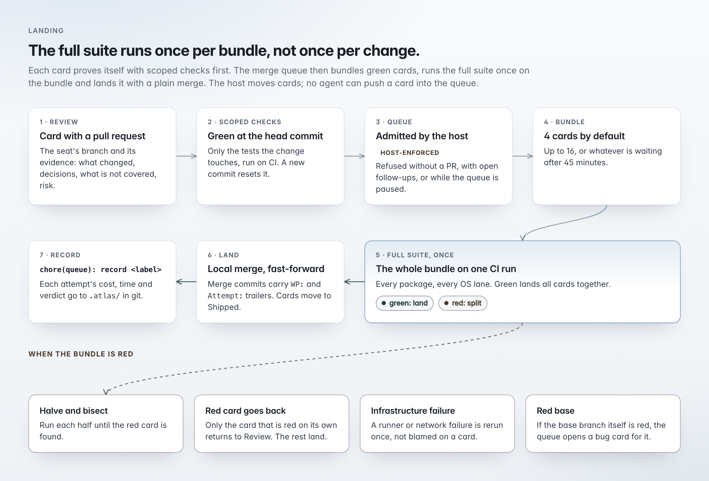

# Coordination

How work moves from a request to a merge: the project board Maestro keeps, the checks and merge queue that decide what lands, and the Guardrails rules every pull request must pass. Read this before you rely on Orchestra to land changes.

## Project board

One board per project: epics, issues, steps, questions, decisions.

- Anyone may create an issue. Only Maestro updates the plan and requests actual movement; seats can record movement requests without changing the stage. The host still moves cards on merge-queue and GitHub facts. Plan writes carry a reason and an activity row. Undo is a new inverse row, so history is never rewritten.
- Facts move cards: dispatch to Building, an opened pull request to Review, a merge to Shipped. A pull request closed without merge flags the card as out of date instead of moving it.
- Delivery forecasts: seeded Monte Carlo over the board's real throughput (1,000 trials).
- Rebuilt from a record committed to the repository (`.atlas/project/board.jsonl`), so it travels with the code.

### Reading an issue

An issue has four areas. **Overview** holds its description, steps, proof, git trail, questions and attachments.
**Conversation** contains comments and a persistent composer, never execution packets. **Executions** groups briefs,
reports, questions, answers and reviews by the attempt recorded by the host. **History** shows changes, movement
requests, actual moves and reasons. Switching areas preserves an unsent comment; opening another issue clears it.
Agents do not have to add titles, summaries or manually authored metadata.

Each document list starts with its four newest records. The latest execution record has a longer excerpt; **Show older
records** reveals four more at a time and focuses the first newly revealed item. Excerpts are taken directly from the
original text, not generated summaries or verified status claims. Comments open as verbatim text; execution documents
open as safely rendered Markdown, with **Original source** always available. Images and other external resources in
notes do not load automatically. Web and email links open through the platform; unsupported links explain how to copy
their address from the source. **Back to records** / **Back to comments** or Escape returns to the list;
Escape in the reader does not close the issue. Reading, filtering and folding do not change the original record or
what Maestro and the seats receive. Historical documents with no recorded attempt stay available separately; they are
not matched by prose or guessed timestamps.

Properties distinguish **Created by**, the creation Session/model, and the current assigned seat. Execution models
come from historical provider turns, not today's Session configuration. Missing historical provenance says **Not
recorded** only after a successful read. Loading and failed reads are distinct, and a failed refresh retains the last
known report with **Retry**. Branches and pull request numbers remain visible. Reading keys in issue content never
switch cards or clear a draft. A late refusal from another issue identifies that original issue rather than appearing
as an error on the newly opened card. Revised vault fields are not cleared by an older save.
An unsaved secret blocks issue/project dismissal, outside clicks and navigation with a save/cancel explanation. **Cancel**
explicitly discards that unsaved value; credentials are not stored in browser storage or restored into a comment.
Toolbar keys never navigate cards. If an earlier write is still running after a project switch, its target is shown while
new writes wait. Project/intake/question refusals identify their own target, not the currently open issue. A successful
creation is acknowledged even if the form was edited during the request; newer edits and their focus remain untouched.

Execution usage covers all exclusively attributable attempts and nested child Sessions, including failed/replaced
attempts and explicitly linked review Sessions. A Session claimed by multiple cards is excluded and identified.
Overlapping roots on the same card count once in its total, but are not guessed into an attempt. Counters distinguish
input, output, reasoning and cache usage. Token totals require recorded usage availability; normalized zeros with
`usageKnown: false`, or historical counters without availability provenance, remain unknown. A retained durable
settlement can supply that availability when an old message projection discarded it. Missing measurements are not zero.
**Reported model cost** includes only positive provider-sourced amounts. Catalog prices, OAuth catalog estimates,
execution-host estimates and historical/source-unknown amounts remain unavailable, not zero-dollar API calls. The
per-turn source is recorded as `provider`, `catalog` or `unavailable`; a provider-reported amount is not an invoice.
Recorded provider-turn elapsed time is summed across parallel Sessions and is not end-to-end
lead time or a measurement of pure model inference time. CI estimates/times belong to the card, not guessed attempts.
CI USD uses published November 2026 standard x64 reference rates, not actual runner size, included usage, discounts
or an invoice. Missing/empty timing and unknown runner kinds remain unavailable and are retried on a later sync.
Per-model amounts identify incomplete reported portions rather than implying a complete bill.
CI discovery must cover all returned pages before totals are attested. Failed or incomplete discovery withdraws that
attestation without erasing earlier cached evidence. Unknown historical runs remain refreshable after another push changes
the PR head. Legacy stored values whose provenance is missing say **Unavailable**, not **Not recorded**, and their digits
stay hidden. GitHub has retired the workflow-run usage endpoint for customers moved to its new billing platform; where
that endpoint is unavailable, card-level timing/cost remains unknown. Repository-level billing is not substituted for it.

New Shipped/Cut transitions append an immutable execution receipt in the same transaction. Reopening preserves earlier
closure receipts. Old terminal cards without a recorded receipt show that gap rather than manufacturing one from
today's measurements. Undo preserves the original receipt, labels it **Undone**, and reopens only the attempts closed
by that unchanged operation; earlier failed attempts stay failed. Older closures without that causal journal refuse undo
with an explicit reopen/redispatch instruction rather than guessing. Current measurements remain under Executions.
If a queue push lands while its card changes, the host records the landed commit but preserves the newer plan and
explicitly asks Maestro to reconcile it; it does not manufacture a Shipped receipt for the preserved stage. An unchanged
queue admission is held so resume cannot automatically rebundle already-landed code; Maestro dequeues and reconciles it first.
The audit says whether a hold was actually applied. These reconciliation-only events do not count as delivered cards in
the conveyor's queue-wait or lead-time metrics.

**New issue** creates an owner-authored proposal in Backlog. Seats use `board_issue` without `number`, and
`board_request_move` with a stage and reason. The host captures the invoking seat, Session and model automatically;
public inputs cannot select trusted authorship. Existing issue updates and `board_move` remain Maestro-only.

Subissues, standalone milestones, labels/priority, dates, templates, saved views, reply threads/mentions/notifications,
batch operations, related/duplicate links and cycles/releases remain follow-on management work; this issue redesign does not claim parity
with Linear or Jira.

## Checks and merge queue

The full suite runs once per bundle instead of once per change. Each card first proves itself with the checks its change touches.

The project declares its checks in `.orchestra/ci.json`: scoped checks per change, a full suite, lanes, a budget and bundle sizes. The file is read from the base branch, so a change cannot loosen its own checks.

<picture>
  <source media="(prefers-color-scheme: dark)" srcset="../images/readme/pipeline-dark.png">
  
</picture>

**Admission** is decided by the host, not an agent. A card is refused unless it is in Review with a complete pull request record, is scoped-green, has a linked repository, does not conflict with its base, has its dependencies met, is not paused, and has no follow-ups that are not yet cards.

| Mechanism | Behavior |
| --- | --- |
| Results per tree | A check result is tied to the tree SHA; identical content is never tested twice. |
| Bundles | 4 cards by default, up to 16, or whatever is ready after 45 minutes; merged together as one pull request. After 50 cards the size adapts to the observed red rate. |
| Red bundle | Halved and bisected. A card red on its own goes back to Review. |
| Infrastructure failure | Rerun once. |
| Flaky test | Recorded as a flake. |
| Red base | Opens a bug card; never reverted automatically. |
| Too many rebuilds | A bundle needing more than two rebuilds is dissolved. |
| No lost work | Every 10 minutes, work in progress (including untracked files) is pushed to a private ref after a gitleaks scan. After a crash, worktrees are restored and no bundle is pushed twice. |
| Base tracking | The base branch is fetched every minute; each queued card is trial-merged against it. |

When a bundle merges, a record commit updates the board record and the [cost ledger](atlas.md#what-each-task-cost). Free text is redacted when the repository is public.

## Guardrails

A rule engine that runs on every change: 78 rules, 53 blocking and 25 warning. Rules match added lines, changed paths or the balance of added and removed lines. Rules and runs are shown under Actions.

- Rules are read from the merge base, so a change cannot weaken the guards that judge it.
- Moved code is recognized and not flagged again.
- Every rule ships with samples that must match and samples that must not.
- Exceptions: an inline `guardrail-ignore` with a written reason (itself reported), or a `guardrail-approved` label that clears one rule on one pull request.
