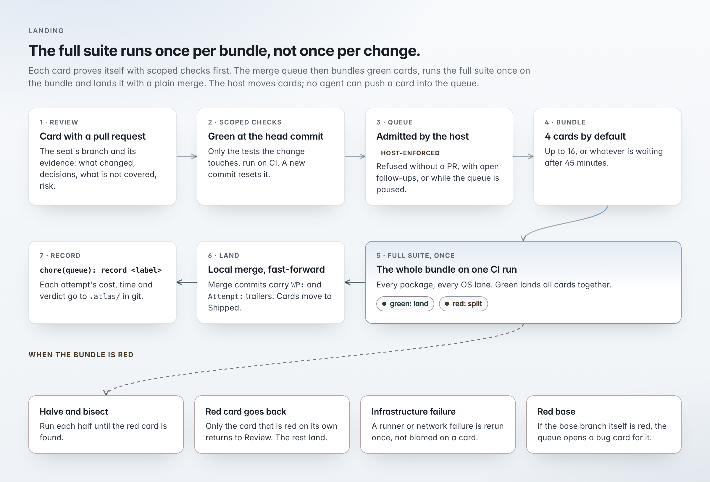

# Coordination

How work moves from a request to a merge: the project board Maestro keeps, the checks and merge queue that decide what lands, and the Guardrails rules every pull request must pass. Read this before you rely on Orchestra to land changes.

## Project board

One board per project: epics, issues, steps, questions, decisions.

- Only Maestro writes to it; every write carries a reason and an activity row. Undo is a new inverse row, so history is never rewritten.
- Facts move cards: dispatch to Building, an opened pull request to Review, a merge to Shipped. A pull request closed without merge flags the card as out of date instead of moving it.
- Delivery forecasts: seeded Monte Carlo over the board's real throughput (1,000 trials).
- Rebuilt from a record committed to the repository (`.atlas/project/board.jsonl`), so it travels with the code.

## Checks and merge queue

The full suite runs once per bundle instead of once per change. Each card first proves itself with the checks its change touches.

The project declares its checks in `.orchestra/ci.json`: scoped checks per change, a full suite, lanes, a budget and bundle sizes. The file is read from the base branch, so a change cannot loosen its own checks.

<picture>
  <source media="(prefers-color-scheme: dark)" srcset="../images/readme/pipeline-dark.png">
  
</picture>

**Admission** is decided by the host, not an agent. A card is refused unless it is in Review with a complete pull request record, is scoped-green, has a linked repository, does not conflict with its base, has its dependencies met, is not paused, and has no follow-ups that are not yet cards.

| Mechanism | Behavior |
| --- | --- |
| Results per tree | A check result is tied to the tree SHA; identical content is never tested twice. |
| Bundles | 4 cards by default, up to 16, or whatever is ready after 45 minutes; merged together as one pull request. After 50 cards the size adapts to the observed red rate. |
| Red bundle | Halved and bisected. A card red on its own goes back to Review. |
| Infrastructure failure | Rerun once. |
| Flaky test | Recorded as a flake. |
| Red base | Opens a bug card; never reverted automatically. |
| Too many rebuilds | A bundle needing more than two rebuilds is dissolved. |
| No lost work | Every 10 minutes, work in progress (including untracked files) is pushed to a private ref after a gitleaks scan. After a crash, worktrees are restored and no bundle is pushed twice. |
| Base tracking | The base branch is fetched every minute; each queued card is trial-merged against it. |

When a bundle merges, a record commit updates the board record and the [cost ledger](atlas.md#what-each-task-cost). Free text is redacted when the repository is public.

## Guardrails

A rule engine that runs on every change: 78 rules, 53 blocking and 25 warning. Rules match added lines, changed paths or the balance of added and removed lines. Rules and runs are shown under Actions.

- Rules are read from the merge base, so a change cannot weaken the guards that judge it.
- Moved code is recognized and not flagged again.
- Every rule ships with samples that must match and samples that must not.
- Exceptions: an inline `guardrail-ignore` with a written reason (itself reported), or a `guardrail-approved` label that clears one rule on one pull request.
