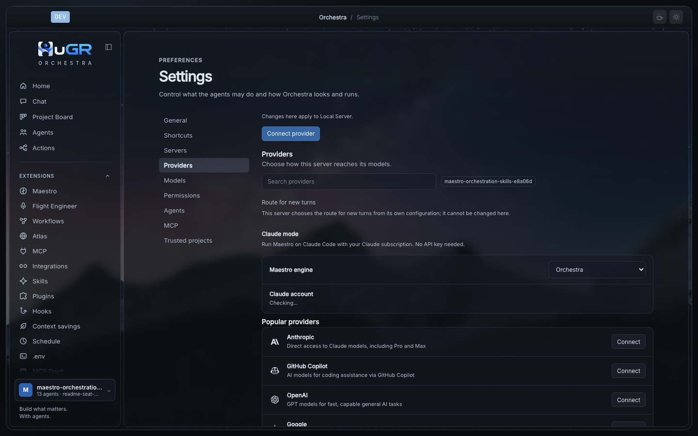
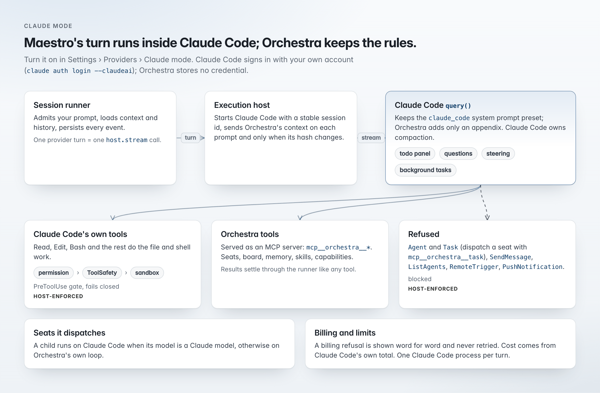

# Models and engines

## Providers

- About 30 built-in provider plugins. Model catalog from models.dev, with an offline snapshot built in. Reasoning level per model.

| Wire protocol | Routed by the session core |
| --- | --- |
| Anthropic Messages | Yes |
| OpenAI Responses | Yes |
| OpenAI-compatible chat | Yes |
| Bedrock Converse | Not yet (implemented in the model layer) |
| Gemini | Not yet (implemented in the model layer) |
| OpenAI Chat | Not yet (implemented in the model layer) |

## Claude mode

Runs an agent's turns inside Claude Code, on your Claude subscription. Turn it on in Settings › Providers › Claude mode. Claude Code signs in with your own account (`claude auth login --claudeai`); Orchestra stores no Claude credential.

Orchestra keeps its rules by treating Claude Code as an execution host for one provider turn, not as a second orchestrator.

<picture>
  <source media="(prefers-color-scheme: dark)" srcset="../images/readme/claude-mode-dark.png">
  
</picture>

| Rule | How |
| --- | --- |
| One turn, one call | The runner still admits your prompt, loads history and persists every event. One provider turn is one call into the host; Claude Code's internal tool calls are stored as events. Claude Code owns compaction inside its session. |
| Claude Code stays Claude Code | `query()` always keeps Claude Code's own system prompt; Orchestra adds only an appendix. Project context goes with each prompt and is resent only when its hash changes. |
| Orchestra's tools, Orchestra's gate | Seats, board, memory, skills and other Orchestra tools are served as an MCP server (`mcp__orchestra__*`). Claude Code's own tools pass a PreToolUse gate running Orchestra's permission rules, ToolSafety and the sandbox, failing closed. `mcp__orchestra__*` calls pass the hook only for the governed-loading check; the runner settles their permissions. |
| Seats stay real sessions | Agent and Task are refused, so a seat is dispatched with `mcp__orchestra__task` and becomes an Orchestra session. SendMessage, ListAgents, RemoteTrigger and PushNotification are refused too. A child seat runs on Claude Code only with a Claude model; otherwise on Orchestra's own loop. |
| Billing passed through | A billing refusal is shown word for word and never retried. Cost comes from Claude Code's own total. Each turn starts one Claude Code process. |

See the [Claude mode guide](claude-mode.md).
