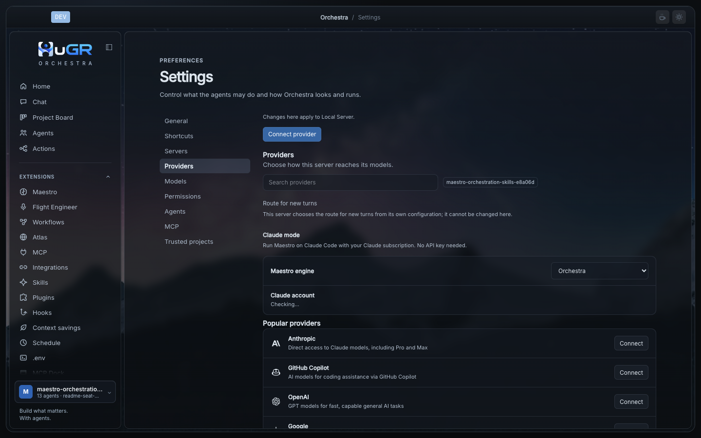
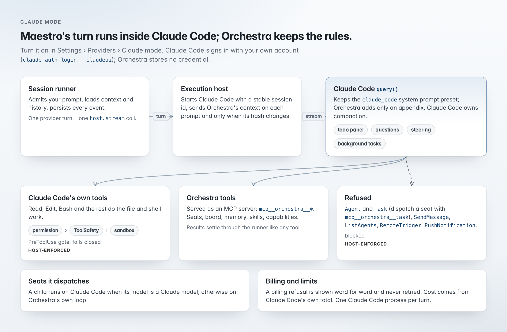

# Models and engines

Which model providers Orchestra can use and how they are routed, plus Claude mode, which runs Orchestra on Claude Code with your Claude subscription. Read this when choosing or connecting a model.

## Providers

- About 30 built-in provider plugins. Model catalog from models.dev, with an offline snapshot built in. Reasoning level per model.

| Wire protocol | Routed by the session core |
| --- | --- |
| Anthropic Messages | Yes |
| OpenAI Responses | Yes |
| OpenAI-compatible chat | Yes |
| Bedrock Converse | Not yet (implemented in the model layer) |
| Gemini | Not yet (implemented in the model layer) |
| OpenAI Chat | Not yet (implemented in the model layer) |

## Project provider configuration

Provider settings from your global config, including custom providers, keep their full behavior. A project must be [trusted](mcp-project-trust.md) before its configuration can change provider destinations, credential environment variables, request headers or bodies, variants, execution limits, capabilities, enabled models or the default model.

Before approval, project provider declarations may change only provider/model names, model families and costs. A project cannot approve itself through its own `trusted_projects` setting. Review its provider configuration before trusting it; approved settings are applied when the catalog is loaded again.

## Native model variants

For Orchestra's native engine, put sampling and token options in `generation`. The model's base options remain in `api.settings.generation`; a selected variant overrides only the fields it supplies. Zero is a valid override, and a variant's `stop` array replaces the base array. In this example, replace `MODEL_ID` with your connected model's ID:

```json
{
  "providers": {
    "openai": {
      "models": {
        "MODEL_ID": {
          "api": {
            "type": "aisdk",
            "package": "@ai-sdk/openai",
            "settings": { "generation": { "temperature": 0.7, "maxTokens": 1024 } }
          },
          "variants": [{ "id": "precise", "generation": { "temperature": 0 } }]
        }
      }
    }
  }
}
```

The canonical generation fields are `maxTokens`, `temperature`, `topP`, `topK`, `frequencyPenalty`, `presencePenalty`, `seed` and `stop`. Each protocol supports its own subset. Use `providerOptions` for protocol-specific settings, such as Anthropic thinking:

```json
{
  "providers": {
    "anthropic": {
      "models": {
        "MODEL_ID": {
          "variants": [{
            "id": "thinking",
            "generation": { "maxTokens": 16000 },
            "providerOptions": {
              "anthropic": { "thinking": { "type": "enabled", "budgetTokens": 12000 } }
            }
          }]
        }
      }
    }
  }
}
```

Move an old variant's `body.temperature` to `generation.temperature`, and its Anthropic `body.thinking` to `providerOptions.anthropic.thinking`. The old body spellings are rejected during native model resolution, before a provider request. Misspelled generation fields are rejected too. Headers and permitted body extensions retain their overlays; protocol-owned fields such as `messages`, `tools` and `model` cannot be overridden through `body`.

Later trusted configuration layers merge generation fields and nested provider options into a variant with the same ID. If `request.variant` names a default variant, that variant must exist. Claude mode retains its host effort selection; this canonical variant lowering applies to the native engine.

Availability is assessed for the selected executor. A connected provider can expose an API that the native engine does not support. A ready assessment checks executor support, current availability, model policies and structural variant options; protocol-specific combinations are checked when preparing the actual request. For example, enabled Anthropic thinking still requires a token budget.

Claude mode checks its cached account status and accepts enabled Anthropic catalog models with supported effort levels. Canonical generation/provider options run through the native engine; Claude mode refuses those options instead of silently ignoring them. Its account status is advisory and cannot guarantee that a later provider call will be accepted.

Clients can request a contextual assessment with `models.execution({ location, context, model })`, backed by `POST /api/model/execution`. Use a context with `type: "session"` and `sessionID` for a prospective selection in an existing Session, or `type: "draft"` before creating one. Both accept an optional `agentID`; a draft can also name a `parentID`. The response retains its Location and contains model entries plus an optional assessment of the exact requested Ref. An unknown candidate remains in `selection` with `model-missing`; it does not become an invented catalog entry. Omitting `model` omits `selection` and does not resolve the execution host's SDK default.

This request does not create a Session, admit a prompt, change its selected agent/model, or start provider/tool work. Invalid Session, parent, agent or Location context returns a declared 404; an invalid Session chain returns 400 and unavailable policy storage returns 503. An assessment can become stale and does not replace validation when executing. Existing model list/default methods keep their global catalog behavior; a secondary host's eligibility does not enable its models globally.

When an assessment is canceled, the server waits for the lookup's cleanup before ending request processing.

## Prompt estimate

For automatic compaction, the heuristic prompt estimate reuses bounded JSON-encoded lengths of identical long text values. The current request structure is serialized afresh for each estimate; whole requests or conversation histories are not cached.

This reuses text-encoding work, not model tokens or provider prompt-cache entries. No token, billing or response-time saving is implied.

## HTTP provider response inactivity

For native HTTP provider calls, including title and compaction requests, reading a response body fails with a non-retryable transport timeout after ten minutes while waiting for the next nonempty response-body chunk. This is a conservative per-pull inactivity limit, not a total response or turn deadline or an absolute wall-clock limit between chunks when the consumer is busy. Raw response bytes reset the wait before parsing, including SSE comments and heartbeats; empty chunks do not. A response that continues making progress can therefore run longer than ten minutes.

This limit begins when the response body is consumed after headers; it is not a connection or header deadline and does not apply to WebSocket or hosted engine iterators such as Claude mode. Developers using a custom `httpJson` transport can set `idleTimeout` on its input or via `.with(...)` to another Effect duration, or `false` to disable it and retain owner-controlled cancellation.

## Claude mode

Runs an agent's turns inside Claude Code, on your Claude subscription. Turn it on in Settings › Providers › Claude mode. Claude Code signs in with your own account (`claude auth login --claudeai`); Orchestra stores no Claude credential.



Orchestra keeps its rules by treating Claude Code as an execution host for one provider turn, not as a second orchestrator.

<picture>
  <source media="(prefers-color-scheme: dark)" srcset="../images/readme/claude-mode-dark.png">
  
</picture>

| Rule | How |
| --- | --- |
| One turn, one call | The runner still admits your prompt, loads history and persists every event. One provider turn is one call into the host; Claude Code's internal tool calls are stored as events. Claude Code owns compaction inside its session. |
| Claude Code stays Claude Code | `query()` always keeps Claude Code's own system prompt; Orchestra adds only an appendix. Project context goes with each prompt and is resent only when its hash changes. |
| Orchestra's tools, Orchestra's gate | Seats, board, memory, skills and other Orchestra tools are served as an MCP server (`mcp__orchestra__*`). Claude Code's own tools pass a PreToolUse gate running Orchestra's permission rules, ToolSafety and the sandbox, failing closed. `mcp__orchestra__*` calls pass the hook only for the governed-loading check; the runner settles their permissions. |
| Seats stay real sessions | Agent and Task are refused, so a seat is dispatched with `mcp__orchestra__task` and becomes an Orchestra session. SendMessage, ListAgents, RemoteTrigger and PushNotification are refused too. A child seat runs on Claude Code only with a Claude model; otherwise on Orchestra's own loop. |
| Billing passed through | A billing refusal is shown word for word and never retried. Cost comes from Claude Code's own total. Each turn starts one Claude Code process. |

See the [Claude mode guide](claude-mode.md).
