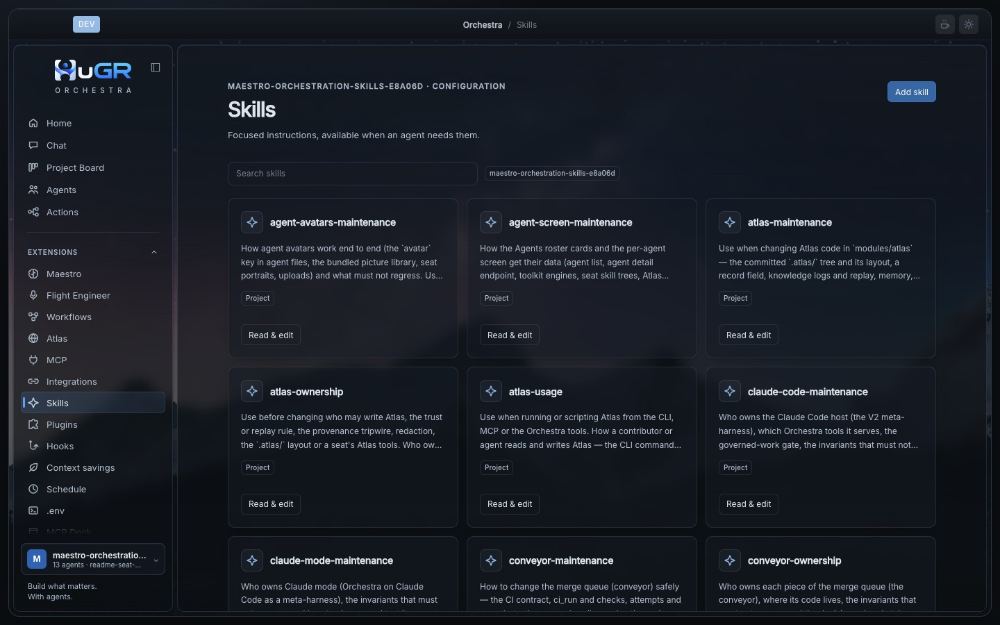

# Tools

Everything an agent can call: the built-in file, shell and web tools, Maestro's own tools, the MCP Dock, the pinned toolkit, skills, plugins and hooks. Read this to know what an agent can do in your project and where each power comes from.

## Built-in tools

| Tool | What it does |
| --- | --- |
| `read` | Files (whole up to 50 KB, then pages of 2,000 lines) and images up to 20 MB. [Details](#read) |
| `write`, `edit` | Write and change files; return the language server's diagnostics for the changed file |
| `apply_patch` | Multi-file patches with tolerant hunk matching; validates every file before writing any |
| `bash` | Commands with a timeout (2 minutes default, 10 at most) and a 1 MB output cap; background jobs through `process_get`, `process_wait`, `process_cancel` |
| `glob`, `grep` | File and content search |
| `webfetch`, `websearch` | Fetch pages (5 MB, converted to Markdown) and search the web. `webfetch` follows up to 5 redirects and asks permission again when one leaves the origin. It refuses a redirect from a public site to a local or private address, and any redirect to a link-local address such as a cloud metadata endpoint, and the error names the blocked target |
| `task` | Delegates to a child session: durable, resumable, can run in the background, up to eight levels deep |
| `todowrite`, `question`, `skill` | Task lists, structured questions to you, skill loading |
| `team_message` | Channel between Maestro and the meeting copilot |
| `context_recall`, `context_compact`, `lean_recall` | [Continuity](context.md#context-continuity) and [Lean](context.md#lean) recall |

Every tool result goes through safety inspection and the size bound before the model sees it.

## `read`

Built so a small file costs as little as possible and a large one can be walked without guessing.

| Input | Behavior |
| --- | --- |
| File up to 50 KB | Returned whole, without line numbers (no tokens spent on a number column) |
| Larger file | Paged with a 1-based `offset` and `limit`, at most 2,000 lines or 50 KB per call; each result says if it was cut (`truncated`) and where the next page starts (`next`) |
| Line over 2,000 characters | Cut with `... (line truncated to 2000 chars)` |
| Directory | One level, directories first, same paging |
| Image (JPEG, PNG, GIF, WebP, up to 20 MB) | Detected by its first bytes, not its extension, and sent as an attachment; resized with Lanczos3 if over 2000 pixels on a side or 5 MB encoded |
| Binary, PDF, invalid UTF-8 | Refused with "Cannot read binary file" or "File is not valid UTF-8" |
| Path outside the working directory | Asks for external-directory permission first; relative paths resolve from the working directory |

*Example:* facing a 4 MB test log, a seat runs `grep` for the failure, then one `read` with `offset` at the line grep reported, and gets a page that starts at the error.

## Maestro's tools

| Group | What it holds |
| --- | --- |
| Planning arsenal | About 25 deterministic tools with validated schemas and declared effects: compile a plan, build its dependency graph, map file conflicts between work packages, freeze shared contracts and generate stubs, judge sliceability, map a repository, check symbol flow, schedule waves, keep a wave ledger. Side effects need explicit authorization. Also served as a standalone MCP server. |
| Governance | Results accepted only on evidence from the real session events, with red-then-green acceptance for tests. Spending metered in token budgets; a model with an unknown price stops the work and asks. |
| Board tools | Read and change projects, epics, issues, steps, questions, decisions and settings; run checks and the merge queue. |
| Decision records | Admissions, plan revisions, approvals, reviews, validations and result decisions as structured records; approvals appear as cards in the chat. |

## MCP Dock

Turns each interface open in the app into an MCP server agents can use.

- Each browser tab is its own server (`dock-<site>`); an isolated Linux desktop is `dock-linux` (runs in a container, needs Docker).
- Tools: `look`, `find`, `act`, `wait`, `navigate`. They read the accessibility tree, not screenshots: no vision model, no image in the context.
- `act` returns only what changed. Caps: 40,000 characters for the `look` outline, 20,000 for page text. Each server also exposes its outline as an MCP resource.

## Toolkit

Specialists use real engines, not reimplementations. Pinned, checksummed versions are fetched once per machine (`orchestra toolkit status`, `orchestra toolkit prefetch`); the Agents screen shows each version.

| For | Engines |
| --- | --- |
| Backend | ast-grep, buf, gitleaks, sqlc, sqlx, squawk, openapi-generator, orval, kiota, kubeconform and others; Go, Java, Node, Python and Rust runtimes |
| Research | rust-analyzer, SCIP indexers, a tree-sitter and SCIP code index |

## Skills

- Loaded from the project (`.orchestra/skills`, `.claude/skills`, `.agents/skills`), your global folder, configured paths, remote indexes and built-in modules.
- A seat's own tree loads level by level from an index that names the next level, so it reads only the depth it needs. A seat's skills are hidden from other agents and embedded in compiled builds.
- The list in the system prompt is bounded: each description is cut at 300 characters, and once the list reaches about 12,000 characters the remaining skills are named without descriptions. The skill tool still loads any of them by exact name.

## Plugins, MCP servers and hooks

| | |
| --- | --- |
| Plugins | Add tools and lifecycle hooks (Promise or Effect APIs) and can extend the terminal UI. Packages have size and entry limits. |
| MCP servers | From the project or your config; start only after you trust the project folder. Sign-ins are stored encrypted. |
| Hooks | "When this happens, if this holds, then": block the action, ask you, remind the agent, require a repair or run a check. Each firing is logged. |
