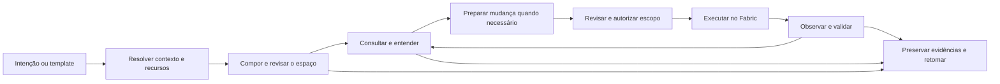
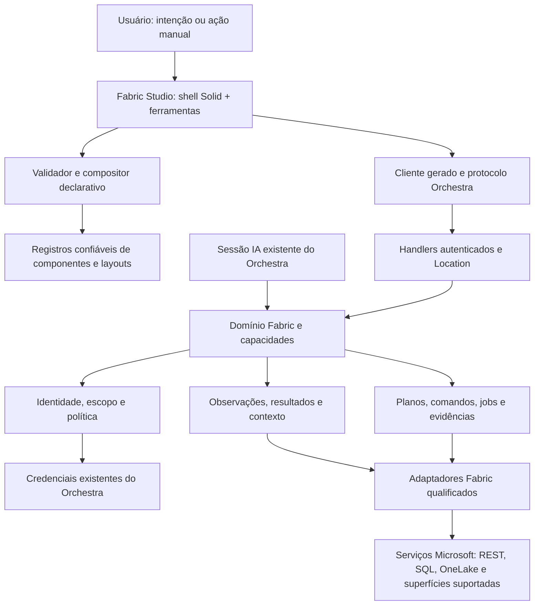
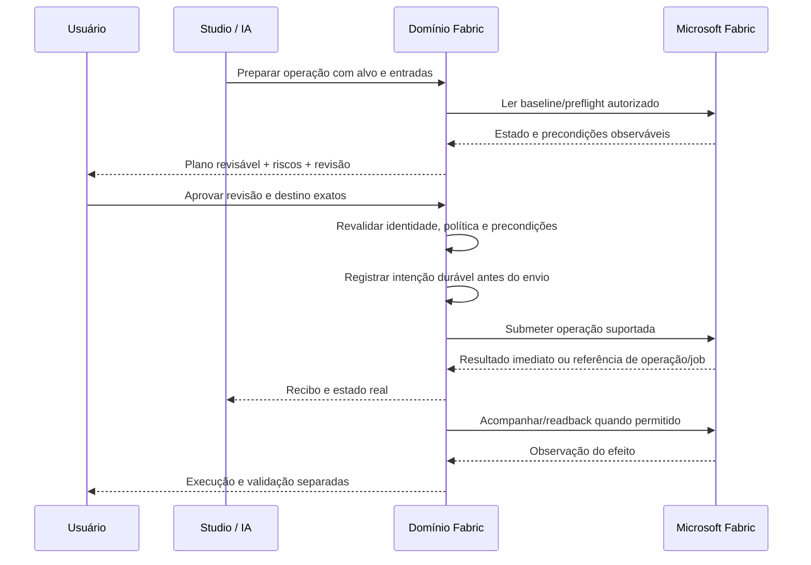

# Fabric Studio — desenho de produto e arquitetura end-to-end

## 0. Estado do documento e convenções

**Estado: desenho E2E proposto, pronto para revisão do proprietário. Não é especificação de implementação nem comprovação de suporte a um tenant.**

- Nome de produto acordado na conversa: **Fabric Studio**, dentro do Orchestra.
- Data de referência: **2026-11-04**. Pesquisa e discovery: [RESEARCH.md](./RESEARCH.md).
- Branch de trabalho: `fabric-workbench`. Baseline inspecionado: `9fcb899d50867c1ddc3f25d8345ac9fd8009d788`.
- Escopo desta entrega: desenho de produto, arquitetura, jornadas, limites e contratos conceituais para originar specs. Não autoriza conexão a tenant, execução remota ou implementação.
- **Firmado** significa direção expressa pelo proprietário nesta conversa; **proposto** significa decisão de desenho a revisar; **documentado** significa capacidade descrita por uma fonte, não testada por nós; **qualificado** será reservado a comportamento verificado numa integração real autorizada.
- Diagramas mostram responsabilidades lógicas, não uma obrigação de criar um serviço ou pacote por caixa.
- Exemplos de declaração e IDs de operações são ilustrativos. As specs congelarão os contratos serializáveis e sua compatibilidade.
- O catálogo de cobertura precisa distinguir visão de produto, disponibilidade da plataforma, disponibilidade no tenant e implementação no Orchestra. Uma dessas dimensões não comprova as outras.

### 0.1 Decisões de produto firmadas

| ID | Direção |
| --- | --- |
| P01 | Fabric primeiro: módulo nativo do Orchestra, não gerador universal de aplicações. |
| P02 | Integração backend preparada e mantida; a IA não inventa endpoints ou funcionalidades. |
| P03 | Frontend declarativo e sob demanda, usando componentes confiáveis em Solid e a linguagem visual do Orchestra. |
| P04 | O usuário descreve o trabalho; o produto organiza ferramentas e contexto para realizá-lo. |
| P05 | Templates pré-montados, em quantidade superior a dez, com adaptação e salvamento. |
| P06 | A unidade de trabalho pode atravessar recursos Fabric: entender, construir, mudar, operar e verificar uma solução. |
| P07 | Interface e IA conduzem o mesmo trabalho; o produto não se resume a chat, inventário ou portal reestilizado. |
| P08 | O desenho precede as specs. Pesquisa independente ajuda a verificar cobertura e limitações. |

### 0.2 Como ler

Seções 1–5 explicam o produto. Seções 6–19 descrevem o sistema end-to-end. Seções 20–23 definem como demonstrar a qualidade e transformar o desenho em specs. A seção 24 registra evidências e corrige expectativas criadas pelos mocks.

## 1. Produto, público e problema

### 1.1 Definição

**Fabric Studio transforma uma intenção de trabalho num espaço operacional coerente sobre o Microsoft Fabric, usando ferramentas já implementadas, recursos autorizados e evidências verificáveis.**

O Fabric continua armazenando dados, executando workloads e aplicando suas permissões. O Orchestra oferece o ambiente para entender, desenvolver, revisar e acompanhar esse trabalho. Não é necessário substituir todas as telas do portal para ser útil.

### 1.2 Por que usar

Uma mudança de negócio costuma atravessar código, tabelas, processos e relatórios. O Studio conserva o contexto entre essas etapas e apresenta o que fazer, o que pode ser afetado e como conferir o resultado. Personalização é o mecanismo; concluir trabalho com clareza e confiança é o benefício.

Proposta em linguagem de usuário: **“Seu Fabric, organizado em torno do que você precisa fazer.”**

O núcleo diferencial proposto é continuidade de trabalho, composição confiável e controle verificável entre workloads. Linguagem natural, múltiplos agentes e memória não são alegações de exclusividade: a Microsoft já oferece capacidades adjacentes, inclusive tarefas persistentes de engenharia. O Studio pode integrar essas capacidades quando o contrato permitir, em vez de competir por duplicação de runtime.

### 1.3 Público e limites da hipótese

Público principal proposto: profissionais que constroem ou mantêm soluções Fabric, especialmente engenheiros de dados, desenvolvedores de BI, operadores e consultores. Analistas e administradores encontram experiências específicas. Um consumidor que só precisa ler um relatório não deve receber uma IDE inteira.

Não realizamos entrevistas nem medimos intenção de compra. Preferência por interface declarativa, ganho de produtividade e confiança nas ações são hipóteses a validar em tarefas reais, comparando também com as ferramentas e agentes da Microsoft.

### 1.4 O que não estamos construindo

- Outro armazenamento, engine Spark, banco analítico ou Power BI.
- Um novo runtime de pipelines concorrente do Fabric.
- Um gerador de HTML/JavaScript arbitrário a partir de prompts.
- Um Terraform universal ou um reconciliador contínuo de todo o tenant.
- Um chatbot que exibe sucesso porque uma chamada HTTP foi aceita.
- Uma promessa de administração irrestrita ou de suporte integral a toda API presente ou futura.
- Um painel obrigatório de “agentes pensando”. O usuário vê trabalho, decisões, resultados e limites.

## 2. Princípios e limites

| Invariante | Regra de desenho |
| --- | --- |
| I01 — Composição não executa | Abrir, importar, gerar, salvar ou reorganizar uma tela não dispara mutação nem job remoto. |
| I02 — Capacidade precede interface | Cada ação exibida aponta a uma operação registrada, suportada e autorizável. Componente bonito não comprova capacidade. |
| I03 — Uma porta de execução | UI manual e IA usam o mesmo domínio de comandos, verificações e recibos; preservam identidades de origem distintas. |
| I04 — Autoridade fora da declaração | Manifestos, nomes de ambiente, templates, prompts e arquivos do projeto não concedem permissões. |
| I05 — Contexto explícito | Servidor Orchestra, projeto/Location, tenant, conexão, identidade efetiva e destino são resolvidos antes do acesso. |
| I06 — Evidência tem alcance | Confirmado, inferido, desatualizado, parcial e desconhecido são apresentados sem converter ausência de visibilidade em ausência de dependência. |
| I07 — Execução não é validação | Aceito, executado e verificado são afirmações diferentes. Uma verificação precisa indicar critério, ambiente e cobertura. |
| I08 — Aprovação exata | Aprovação vincula revisão, conteúdo, parâmetros, identidade, destino, efeitos e precondições; mudanças relevantes invalidam a autorização. |
| I09 — Falha não apaga efeitos | Falha parcial ou resposta perdida conserva o que sabemos. Sem retry cego de efeitos não idempotentes. |
| I10 — Usuário mantém a mesa | A IA propõe reorganizações; não substitui silenciosamente a organização ou os rascunhos do usuário. |
| I11 — Sem escalada implícita | Falta de API ou permissão não autoriza shell, browser automation, identidade mais privilegiada ou credencial alternativa. |
| I12 — Dados têm destino | Resultados em tela, cache, exportação e contexto enviado a modelo são exposições distintas e controladas. |
| I13 — Leitura também custa | Consultas, scans, testes e previews têm limites e intenção; não são atividade invisível ilimitada de widgets. |
| I14 — Infraestrutura existente primeiro | Reaproveitar contratos e serviços Orchestra quando o alcance real atende à necessidade; não declarar generalidade que o código não possui. |

Esses invariantes são propostos como requisitos transversais das specs. Nenhuma restrição de segurança depende apenas de texto no prompt ou de desabilitar um botão.

## 3. Modelo mental e vocabulário

| Conceito | Significado e dono |
| --- | --- |
| Conexão Fabric | Conta/identidade e política de acesso a superfícies Microsoft. Referencia credenciais, nunca as incorpora à tela. |
| Destino | Escopo remoto explicitamente selecionado: tenant, workspace, recurso e ambiente reconhecido pelo servidor. |
| Solução | Agrupamento de negócio como “Faturamento”, associado a recursos e dependências com proveniência. Não equivale a um workspace Fabric. |
| Espaço de trabalho do Studio | Declaração de ferramentas, ligações e organização para uma tarefa. Evitar chamá-lo apenas de workspace quando houver ambiguidade. |
| Template | Definição reutilizável de um espaço, com parâmetros, dependências e limitações. |
| Componente | Ferramenta Solid confiável, com propriedades, fontes aceitas, seleções e ações tipadas. |
| Capacidade | Operação backend conhecida com entradas, saídas, efeitos, autorização e suporte descritos. |
| Observação | Informação obtida numa identidade/escopo/revisão/tempo; pode estar parcial ou antiga. |
| Mudança | Intenção e revisões do plano que prepara alterações de recursos. Não é uma alteração da disposição da tela. |
| Execução | Tentativa de realizar um comando aprovado ou uma operação manual permitida. |
| Job remoto | Trabalho identificado pelo provedor. Pode continuar após fechar a UI. |
| Validação | Critério e observação que verificam uma afirmação; tem escopo e resultado próprios. |
| Recibo | Referência durável ao que foi solicitado, aceito, observado e concluído, sem segredo embutido. |

**Separação obrigatória:** `Location.workspaceID` do Orchestra não é o ID de workspace Microsoft Fabric. Nenhum campo é reutilizado com os dois significados. Uma sessão também não é uma conexão nem uma autorização permanente.

## 4. Experiência completa: da entrada ao trabalho concluído

### 4.1 Entrada e onboarding

1. Abrir **Fabric Studio** no Orchestra. Explicar o benefício com uma tarefa concreta, não com uma lista de siglas.
2. Escolher demonstração sem dados reais ou conexão real. Os modos são visualmente distintos e não compartilham recibos.
3. Entrar na conta Microsoft pelo fluxo aprovado. Mostrar organização, identidade e onde o servidor Orchestra está executando.
4. Selecionar os workspaces e destinos permitidos. O Studio restringe seu escopo, mas não altera as permissões Microsoft nessa seleção.
5. Inspecionar capacidades com probes de metadados limitados. Exibir o que está pronto, exige consentimento, é negado, não foi verificado ou não é suportado.
6. Escolher template, trabalho recente ou descrever a intenção. Consentimentos de dados/modelo são separados do login Microsoft.
7. Abrir um espaço legível com estado vazio útil. Não inventar descobertas nem iniciar scan de dados automaticamente.

Sem assinatura de IA, o usuário ainda deve poder escolher templates e usar as ferramentas manuais disponíveis. A composição por linguagem natural informa o provedor/modelo selecionado e seus limites de dados.

### 4.2 Estrutura da experiência

```text
Orchestra
└─ Fabric Studio
   ├─ Começar: intenção, templates, recentes
   ├─ Conexões e destinos
   ├─ Soluções e recursos autorizados
   ├─ Espaço atual
   │  ├─ objetivo e contexto
   │  ├─ ferramenta principal + ferramentas de apoio
   │  ├─ inspeção da seleção
   │  └─ assistência IA recolhível
   ├─ Mudanças e aprovações
   └─ Execuções, evidências e histórico
```

Não criar três universos de “chat”, “manual” e “automação”. Uma execução pode ser iniciada manualmente, investigada com IA e revisada numa tela, mantendo referências compartilhadas.

Entrada sugerida: **“O que vamos fazer?”**, com busca por intenção, templates disponíveis e trabalhos recentes. O modo avançado pode começar diretamente por recurso, editor ou consulta. Nenhum dos dois precisa passar por um tour ou pela tela de plano de mudança para fazer uma leitura simples.

### 4.3 Transições, não um wizard universal



“Consultar” pode terminar sem mudança. “Investigar” pode permanecer em leitura. “Construir” pode conter várias revisões. “Publicar” é apenas uma espécie de operação, não o fim obrigatório de toda tarefa.

### 4.4 Estados que o usuário precisa reconhecer

| Estado | Resposta da experiência |
| --- | --- |
| Sem conexão | Demonstração ou conectar; não mostrar dados fictícios como reais. |
| Conta sem acesso | Explicar o escopo solicitado e oferecer escolher outro destino; não pedir admin indiscriminadamente. |
| Recurso ambíguo | Seletor com organização, workspace e tipo; não escolher pelo nome mais parecido. |
| API não suportada | Ferramenta indisponível com motivo e alternativa manual/deep link seguro. |
| Resultado parcial | Mostrar cobertura e falhas por origem; evitar total global enganoso. |
| Resultado antigo | Idade e ação de atualizar; dados de revisão antigos não autorizam execução atual. |
| Offline | Espaços e evidências locais autorizados; sem promessa de status remoto atual e sem fila oculta de comandos. |
| IA indisponível | Preservar rascunho e ferramentas manuais. |
| Job em andamento | Acompanhamento independente do painel; fechar painel não significa cancelar. |
| Autorização revogada | Bloquear novos acessos e reavaliar caches/contexto; mostrar instrução de reconectar. |
| Resultado desconhecido | Mostrar reconciliação pendente; não oferecer “tentar de novo” como ação inofensiva. |

## 5. Jornadas de referência

### J01 — Conhecer um legado

- Ator: engenheiro/consultor entrando num ambiente existente.
- Pedido: “Como os pedidos chegam ao relatório de receita?”
- Ações: resolver relatório, inspecionar definições autorizadas, combinar relações explícitas e inferências do código, montar mapa e inspector.
- Resultado: caminho documentado com fontes e lacunas. Nenhuma inferência é promovida a verdade por aprovação informal da explicação.
- Limites: scanners administrativos não são pré-requisito silencioso; se faltar acesso ao modelo, o mapa termina nessa lacuna.
- Conclusão: usuário identifica etapas e sabe onde uma regra é aplicada. Documento/mapa é uma fotografia datada, não garantia de dependências completas.

### J02 — Alterar regra de receita

- Pedido: “Excluir cancelamentos do faturamento sem apagar a origem.”
- Esclarecimentos: quais status contam, vigência, histórico retroativo, fonte de verdade, consumidores conhecidos e critério de conferência.
- Plano: alterações exatas nas definições suportadas, grafo de ordem, ambiente de teste explicitamente mapeado, validações antes/depois e estratégia de recuperação por etapa.
- Revisão: regra de negócio em linguagem natural, diff técnico acessível, dados que podem ser lidos, objetos afetados, efeitos desconhecidos e custo esperado sem precisão fictícia.
- Execução: ensaio autorizado em teste; revisão separada para produção; verificação depois da execução real.
- Falhas: código alterado externamente invalida plano quando detectável; aplicação parcial conserva recibos e exige reconciliação.
- Conclusão: prova de escopo definido, nunca “o faturamento inteiro está correto” por um teste com amostra.

### J03 — Investigar e corrigir uma carga

- Pedido: “A atualização de hoje falhou; compare com a última execução que funcionou.”
- Espaço: execuções + log disponível + dependências + comparação de parâmetros/definições.
- IA: hipóteses apontam a evidências; erro de autenticação não vira sugestão de remover controles.
- Comando: nova execução exige considerar se repetir duplica dados ou efeitos externos. Só habilitar retry seguro com suporte e precondições conhecidas.
- Conclusão: causa confirmada ou hipótese não resolvida; eventual correção e execução vinculadas, com conferência do destino.

### J04 — Construir uma carga nova

- Pedido: “Trazer pedidos diariamente, com atualização incremental e conferência do total.”
- Esclarecimentos: fonte/conector disponível, credencial/gateway, agenda, chaves, watermark, dados atrasados, duplicidade, destino e SLA de negócio.
- Artefatos: definições e código suportados, dados de teste controlados, validações e documentação da regra.
- Execução: Fabric é o dono do pipeline e da agenda. O Studio prepara/configura/acompanha, sem criar engine paralela.
- Conclusão: processo operável, executado e verificado no escopo acordado; não apenas notebook que abriu.

### J05 — Explorar e consultar

- Usuário escolhe tabela/modelo e inspeciona metadados antes de consultar.
- Execução de SQL/DAX/KQL mostra identidade, alvo, limite e possível consumo. Comandos não ganham classificação de leitura por começar com `SELECT` ou conter determinada palavra.
- Resultado: linhas retornadas, truncamento, filtros, instante e contexto de segurança. Exportação e envio ao modelo são ações próprias.
- Conclusão: resposta utilizável, com consulta reproduzível e sem obrigação de criar uma mudança.

### J06 — Acesso e governança

- Pedido: “Quem pode acessar os dados financeiros?”
- Separar papéis de workspace, acesso a item, SQL, OneLake e segurança do modelo. Não somar isso como se uma única lista fosse o acesso efetivo completo.
- Mostrar grupos não expandidos, identidades não resolvidas e políticas desconhecidas.
- Recomendações de remoção precisam de contexto organizacional autorizado; troca de time não pode ser inferida só do nome do usuário.
- Conclusão: revisão de escopo explícito. Alterações de acesso usam confirmação forte e validação de readback; observar a configuração não comprova a experiência de cada usuário final.

### J07 — Retomar e compartilhar

- Fechar o app preserva a composição salva, os rascunhos escolhidos e as referências de execução; não garante que um worker local permaneça ativo.
- Ao reabrir, revalidar identidade, capacidades e permissões antes de reconsultar. Jobs remotos existentes podem ser reconciliados sem reenviar seu comando original.
- Compartilhar significa, inicialmente, exportar/importar composição sanitizada e resolver referências com a conta do destinatário. Compartilhamento de dados e colaboração multiusuário exigem um serviço autorizado próprio; não são pressupostos da instalação desktop.

### J08 — Trabalhar sem repositório

- Ator: analista ou operador que usa Fabric e não desenvolve num repositório Git.
- Entrada: abrir Studio, conectar conta, escolher uma consulta ou investigação e salvar o trabalho sem criar um repositório fictício.
- Proposta: contexto de trabalho próprio do Studio, associado ao servidor e à identidade do operador; pode vincular-se a um projeto existente ou a uma área de trabalho gerenciada sem Git. Para sessões que exigem Location, usar placement real resolvido pelo servidor, não ID de workspace Microsoft.
- Restrição observada: `packages/core/src/project.ts` resolve diretório sem Git para `Project.ID.global`. Portanto, diretório gerenciado não cria automaticamente um projeto isolado. O desenho de armazenamento/autorização precisa preservar contexto do Studio e Location/diretório, sem conceder acesso por igualdade de `Project.ID.global`.
- Conclusão: espaço salvo, retomado e autorizado sem Git; conexão, rascunhos e dados não vazam entre contextos não-Git. Esta jornada é critério obrigatório da spec de placement, não um onboarding que exige “inicializar repositório”.

## 6. Arquitetura geral e integração com Orchestra

### 6.1 Blocos lógicos



O domínio Fabric é a porta de aplicação das capacidades preparadas. O compositor não recebe credenciais e não chama Microsoft diretamente. MCP oficial pode ser um transporte para operações qualificadas, não uma autorização para a UI aceitar qualquer ferramenta descoberta.

### 6.2 Encaixe no repositório observado

| Superfície existente | Evidência | Direção proposta |
| --- | --- | --- |
| Registro lazy de chapters e providers de SDK | `packages/app-shell/src/orchestra/chapter-route.tsx` | Adicionar chapter Fabric com controller/context próprios; respeitar seleção de servidor e Location. |
| Navegação e design kit | `packages/app-shell/src/orchestra/navigation.ts`, `chapters/kit.tsx`, `chapters/kit.css`, `orchestra/DESIGN.md` | Reusar shell, tokens, i18n e padrões; não transportar o CSS do mock como produção. |
| Controller, rail e inspector de um chapter complexo | `packages/app-shell/src/orchestra/chapters/atlas/atlas.tsx` | Referência de composição/lifecycle, não dependência no domínio Atlas. |
| Contratos browser-safe | `packages/schema/src/capability.ts` e `packages/schema/AGENTS.md` | Contratos públicos mínimos Fabric/Studio aqui; comportamento no domínio proprietário. |
| HttpApi e handlers | `packages/protocol/src/api.ts`, `packages/server/src/handlers/` | Grupos e handlers tipados; SDK regenerado em `packages/client` quando mudar API pública. |
| Integração OAuth e credenciais | `packages/core/src/integration.ts`, `credential.ts`, `credential/cipher.ts` | Reusar armazenamento e lifecycle; acrescentar fluxos Microsoft necessários sem vazar segredos ao client. |
| Setup atual de capacidades | `packages/schema/src/capability-setup.ts`, `packages/core/src/capability/connection/setup.ts` | O contrato observado é key/bearer com lista fechada de providers; não é um conector OAuth Fabric pronto. A extensão exige contrato deliberado. |
| Identidade de operador e escopo | `packages/core/src/capability/operator/contract.ts` | Vincular ação manual a operador autenticado, não a uma sessão de agente fictícia. |
| Política de ferramenta de agente | `packages/core/src/capability/policy.ts` | Preservar vínculo real da invocação e deny floor; esse contrato não é automaticamente uma política de UI. |
| Resultados e jobs de capacidade | `packages/schema/src/capability.ts`, `packages/core/src/capability/job/` | O store conserva metadados e provas de produtor; não implementa polling/cancel/recovery remoto automaticamente. Acesso manual precisa de fronteira própria. |
| Actions | `packages/core/src/actions.ts` | Seu reader atual é GitHub/GitLab; não presumir que seja um runtime genérico de Fabric. Reusar conceitos só após examinar compatibilidade. |

Localização exata do runtime Fabric — módulo dedicado ou domínio Core — será decidida na spec de arquitetura com os boundaries do repositório. A recomendação é isolar o pacote de domínio Fabric quando isso couber no grafo, mantendo contratos públicos mínimos em Schema e transportes em Server. Não criar uma camada genérica nova só para acomodar o nome “Studio”.

### 6.3 Fronteiras obrigatórias

- Client runtime depende de Schema/Protocol; não importa Core/Server.
- Schema não hospeda registries runtime, clientes Microsoft ou dependências de drivers.
- Core/Protocol ficam abaixo de Server na direção de dependências do projeto.
- Não duplicar event definitions para facilitar geração. Eventos públicos só quando um consumidor atual precisa deles.
- O chapter carrega o necessário lazy; drivers SQL, parsers pesados e editores não entram indiscriminadamente no startup.
- Nenhuma bridge Rust/Electron é necessária só por chamar o módulo de nativo. Recurso host-specific exige justificativa própria.
- Não modificar nem reiniciar a instância do proprietário para pesquisar ou demonstrar este desenho.

## 7. Catálogo de capacidades Fabric

### 7.1 Catálogo preparado, disponibilidade contextual

O catálogo representa operações implementadas, não possibilidades que um prompt pode criar. Cada descrição precisa conter:

- ID estável e revisão/schema hash; superfícies e tipos de recurso aceitos.
- Entradas/saídas estruturadas; limites e como representar resultado parcial.
- Classificação de efeitos: metadados, leitura de dados, execução com consumo, escrita de definição, escrita de dados, mudança de acesso ou destruição.
- Identidades aceitas, audiences/scopes, papéis e settings de tenant exigidos.
- Status de plataforma e da implementação, incluindo preview e restrições de região/rede/licença.
- Preflight possível, precondições e suporte a atualização condicional.
- Semântica de idempotência, submissão, acompanhamento, cancelamento e recuperação.
- Políticas de dados, logs, limites de payload e evidências disponíveis.
- Provas de qualificação e data da última revisão de documentação.

Disponibilidade não é apenas booleano. A UI diferencia desabilitado, não instalado, autenticação necessária, acesso negado, não suportado, ainda não verificado, pronto e degradado/partial. A tradução para os enums existentes ou novos pertence à spec; não confundir readiness de conexão com autorização de uma operação específica.

### 7.2 Política de integração

Preferir APIs e protocolos oficiais diretamente quando fornecerem contratos estáveis para a operação. MCP oficial e SDK/CLI podem ser adaptadores, desde que identidade, efeitos e resultados permaneçam verificáveis. Não usar descoberta de ferramenta como prova de segurança ou correção.

CLI, quando realmente necessária, é opcional e passa pelas abstrações de processo do Orchestra, com binário conhecido, parâmetros estruturados e ambiente mínimo. Nunca interpolar SQL, tokens ou argumentos de shell a partir da declaração. Ausência de API não dispara automação de navegador como fallback invisível.

### 7.3 Mapa da plataforma

O inventário está em [COVERAGE.md](./COVERAGE.md). Cada família tem objetivos, superfícies candidatas, limitações e uma disposição explícita no produto. Não há família “pronta” apenas por estar nessa lista. O status inicial da implementação é **desenho**, e a disponibilidade real será decidida pela qualificação contextual de cada operação.

Unidade de qualificação proposta: **operação × tipo/geração/formato do item × identidade efetiva × permissões/scopes × capacidade/região/rede**. “Suporta Dataflow” ou “suporta service principal” é uma descrição insuficiente.

### 7.4 Regras específicas que a abstração não pode esconder

- SQL analytics endpoint de Lakehouse permite ler os dados Delta, não gravar neles por INSERT/UPDATE/DELETE. Objetos SQL de metadados não tornam o endpoint um Warehouse gravável.
- Notebook CRUD, execução completa, sessão Livy, logs e saída por célula são capacidades diferentes. Não montar um “Jupyter completo” com um endpoint de job que devolve apenas estado/exit value.
- Dataflows Gen2 e variantes CI/CD precisam de uma matriz própria de suporte. Documentação conflitante é bloqueio de qualificação, não motivo para escolher a interpretação conveniente.
- Consulta de modelo por REST DAX, XMLA e Fabric IQ MCP tem permissões e limitações diferentes. Não impor Build como requisito universal de leitura nem presumir que uma identidade de editor demonstra RLS de Viewer.
- Power BI Report, Power BI Dashboard e Real-Time Dashboard não são o mesmo recurso nem usam necessariamente o mesmo embedding.
- Fonte, conexão/gateway e identidade de execução de uma atividade são diferentes da identidade que chama a API de controle.
- Administração de capacidade via Azure acrescenta superfície/identidade/RBAC próprios; não é extensão automática do acesso ao workspace.
- Git/definições não preservam todos os dados, credenciais e settings. Deployment pode deixar efeitos parciais sem rollback automático.

Fontes e conflitos estão no inventário; essas regras serão requisitos dos adaptadores, não apenas avisos de documentação.

## 8. Sistema declarativo de espaços de trabalho

### 8.1 Dois documentos diferentes

1. **Declaração de espaço:** o que mostrar, como organizar e como conectar seleções. Não executável.
2. **Plano de mudança:** comandos, destinos, conteúdo, precondições, efeitos e validações. Executável somente por uma autorização válida.

Salvar um espaço não aplica um plano. Importar template não instala conector, concede acesso, inicia uma consulta de dados ou publica um recurso.

### 8.2 Contrato conceitual da declaração

```yaml
format: fabric-studio.workspace
version: 1
title: Investigar a carga de vendas
layout: investigate
context:
  targetRef: target-comercial
  solutionRef: faturamento
tools:
  - id: runs
    component: fabric.run-list
    slot: main
    source:
      capability: fabric.execution.list
      resourceRef: carga-diaria
  - id: logs
    component: fabric.run-log
    slot: support
    source:
      capability: fabric.execution.logs
  - id: details
    component: fabric.resource-inspector
    slot: inspect
bindings:
  - from: { tool: runs, port: selectedExecution }
    to: { tool: logs, port: execution }
  - from: { tool: runs, port: selectedExecution }
    to: { tool: details, port: resource }
    projection: executionResource
```

Nomes e formato acima são ilustrativos. `targetRef` e `resourceRef` são referências resolvidas no servidor. Não são URLs livres nem autorização. As fontes são operações de consulta conhecidas; comandos mutantes são apresentados por componentes como ações deliberadas, não representados por efeitos de binding.

Campos proibidos: credenciais, bearer tokens, HTML, CSS livre, JavaScript, imports, binários, strings de shell, URLs arbitrárias de backend, políticas que elevem permissões e expressões de execução geral. Identificadores desconhecidos falham de forma explícita. Títulos, texto e conteúdo remoto são dados não confiáveis, escapados e sem poder de tool invocation.

### 8.2.1 Portas e bindings tipados

- Cada componente registra portas de entrada/saída e seus tipos; por exemplo, `ExecutionRef?`, `ResourceRef?` ou conjunto de recursos. ID/string solto não é referência suficiente.
- No exemplo, `runs.selectedExecution` produz `ExecutionRef?` e `logs.execution` consome o mesmo tipo. A fonte de logs recebe o argumento pela porta validada do componente, não por uma segunda expressão paralela de seleção.
- `details.resource` só aceita `ResourceRef?`. A conversão de execução para seu item usa `executionResource`, uma projeção pura e registrada pelo produto, preservando tenant/conexão/destino. Não é uma expressão de propriedade livre que o manifesto pode executar.
- Compatibilidade inclui tipo, identidade/escopo de referência, cardinalidade, nulabilidade e snapshot/revisão. Muitos recursos não viram um único recurso por escolher o primeiro silenciosamente.
- Seleção vazia coloca dependentes em “selecione uma execução”, invalida o resultado anterior e suspende a fonte dependente. Resposta atrasada não pode preencher o contexto novo.
- Rejeitar: ligar `QueryResult` a `ExecutionRef`; ligar recurso de outro tenant; escolher endpoint/ação com valor vindo de uma row; binding que dispara `run`/`delete`; projeção desconhecida; ciclo.
- Binding transfere contexto permitido, não consentimento. Uma nova seleção não amplia a autorização nem o orçamento de consulta já concedidos.

### 8.3 Pipeline de compilação


- YAML é formato de autoria/conveniência; modelo canônico é JSON tipado. Sem tags customizadas, aliases expansivos ou execução de constructors. Tamanho, profundidade e cardinalidade limitados.
- Schema público canônico em Schema; renderer valida estruturalmente para preview. O servidor valida autoritativamente persistência, binding e acesso. Não manter duas definições divergentes do mesmo contrato.
- Validação semântica rejeita slots inexistentes, dependências incompatíveis e fontes que não alimentam o tipo de componente.
- Binding é uma ligação tipada de seleção/filtro permitido. Não é linguagem de programação, JSONPath irrestrito nem event bus aberto.
- Grafo de bindings precisa ser acíclico e limitado, ou ter uma semântica de ciclos explicitamente especificada; primeira proposta: rejeitar ciclos.
- Defaults são determinísticos, ligados à versão do registry/layout; toda normalização relevante fica visível na declaração efetiva.
- Validação não dispara probes custosos ou comandos. Requerimentos não satisfeitos produzem diagnóstico por ferramenta, não tela quebrada ou falso sucesso.

### 8.4 Geração pela IA e edição pelo usuário

IA recebe uma descrição limitada dos componentes/capacidades disponíveis e um contexto autorizado. Propõe declaração, não código de renderer. A resposta é tratada como entrada não confiável e passa pelo mesmo compilador de um arquivo importado.

Quando o usuário já tem um espaço, IA propõe um patch de revisão base, preserva IDs estáveis e mostra “adicionar logs”, “abrir diff” ou “mudar ferramenta principal”. Rascunhos sujos não são descartados. Conflito de revisão pede reconciliação, sem last-writer-wins silencioso.

Usuário pode editar visualmente, usar templates ou abrir modo avançado declarativo. A declaração efetiva pode ser inspecionada/exportada sem exigir esse conhecimento para uso normal.

### 8.5 Compatibilidade

Versionar separadamente formato do documento, catálogo de componentes, schemas de capacidade e revisão do espaço. Uma migração de layout não renova uma aprovação de execução.

Componente removido/incompatível preserva o documento e apresenta diagnóstico. Não reinterpreta um ID antigo como ação nova. Migrations geram revisão nova e não executam tarefas. Atualização de template é opt-in, com diff sobre customizações locais.

Documento inválido não vira uma tela parcialmente executável. A UI preserva o texto para correção, com diagnóstico localizado. Documento estruturalmente válido com capacidade conhecida indisponível pode ser salvo e aberto em modo degradado, indicando o painel bloqueado. Isso é diferente de aceitar um componente/ação desconhecido por fallback permissivo.

## 9. Composição visual, componentes e acessibilidade

### 9.1 Biblioteca de ferramentas

| Família | Ferramentas propostas | Contrato visual/interativo |
| --- | --- | --- |
| Contexto | Seletor de tenant/destino, breadcrumb, identidade, capacidades | Nunca ocultar mudança de ambiente/identidade. |
| Exploração | Resource explorer, schema browser, arquivos, catálogo | Seleções tipadas, paginação, busca com escopo. |
| Relações | Mapa da solução, dependências, impacto | Evidência por aresta, filtro, alternativa textual acessível. |
| Dados | Query editor, tabela de resultados, perfil, gráfico | Tipo de engine, truncamento, filtros, fonte e custo; gráfico não inventa agregação. |
| Autoria | Notebook, SQL, definição de pipeline, modelo semântico | Edição local não salva remoto; diff e revisão explícitos. |
| Operação | Run list, timeline, logs, parâmetros, status | Distinguir o que o provedor expõe do que não está disponível. |
| Mudança | Plano, diff, impacto, preflight, aprovação | Revisão congelada e efeitos concretos; confirmação não fica em conteúdo gerado pelo modelo. |
| Confiança | Testes, reconciliação, proveniência, recibos | Não confundir quantidade de checks com cobertura. |
| Administração | Matriz de acesso, settings, capacidade/consumo | Diferenciar identidade efetiva, permissão observada e acesso calculado parcial. |
| Assistência | Conversa contextual, propostas e explicações | Recolhível, não a única forma de operar. |

Famílias especializadas podem exigir visualizador de documento Cosmos, mapa geográfico, editor de regras de evento, experimento ML ou inspector GraphQL. Esses componentes seguem o mesmo registry/contrato; não recebem HTML remoto ou ações arbitrárias para imitar suporte. Reutilização visual não pode apagar o modelo mental específico do workload.

Registro do componente declara props permitidas, tipos de dados, seleções emitidas, slots possíveis, tamanho mínimo, states, lazy loader e ações conhecidas. Ações são resolvidas pelo contexto confiável, não funções JavaScript serializadas.

### 9.2 Recipes de layout

| Recipe | Principal | Apoio | Inspeção |
| --- | --- | --- | --- |
| Explore | Recursos ou dados | Consulta/perfil em abas | Recurso selecionado |
| Investigate | Execuções/timeline | Logs, mapa, comparação | Evento/erro selecionado |
| Edit | Editor | Estrutura, resultados, parâmetros | Referência ou execução |
| Review | Plano/diff | Impacto e validações | Alteração selecionada |
| Build | Fluxo/definição | Fontes, regras, testes | Etapa selecionada |
| Operate | Estado do processo | Histórico, consumo, pendências | Incidente selecionado |

Recipes são organizações reconhecíveis, não seis aplicações independentes. Uma principal, apoio limitado e inspector ajudam a evitar mosaico de widgets. O número máximo de painéis simultâneos e seus mínimos serão fixados e medidos na spec de compositor.

### 9.3 Customização com estabilidade

Redimensionar, recolher, ordenar, trocar principal, fixar recurso, usar abas e salvar cópia. O componente mantém identidade ao mover, para não perder rascunho nem reenviar consulta. Ajustes responsivos preservam a intenção de organização, sem sobrescrever a preferência desktop com o colapso mobile.

Fixar ferramenta e fixar recurso são ações distintas: a primeira preserva sua posição/presença; a segunda mantém sua seleção, mostrando que deixou de acompanhar a seleção geral. Modo de organização bloqueado impede rearranjo automático. Mudanças de composição têm aceitar/rejeitar/desfazer; desfazer layout nunca desfaz um comando Fabric.

Preferências duráveis de abas, ordem, tamanhos e pins pertencem à revisão salva do espaço pessoal, como overrides da receita. Seleção efêmera, foco, scroll e estado de carregamento pertencem à instância. Fixação de recurso durável exige referência explícita sanitizada na revisão, revalidada ao reabrir. A spec não deve armazenar o mesmo ajuste em dois lugares concorrentes.

Sem cores arbitrárias, posicionamento absoluto livre ou CSS gerado. Layout deriva dos tokens e recipe. Avisos de destino, autorização e resultado desconhecido não podem ser escondidos por template.

### 9.3.1 Anatomia de uma tela composta

```text
┌───────────────────────────────────────────────────────────┐
│ Objetivo · solução · identidade · destino · estado real    │
├──────────────────────────────────────────┬────────────────┤
│                                          │                │
│ Ferramenta principal                     │ Apoio em abas  │
│ (consulta, execução, mapa, editor, plano) │                │
│                                          ├────────────────┤
│                                          │ Inspector da   │
│                                          │ seleção/pin    │
├──────────────────────────────────────────┴────────────────┤
│ Ação da tarefa + estado/custo; assistência IA opcional     │
└───────────────────────────────────────────────────────────┘
```

É um papel de organização, não coordenadas obrigatórias para todo recipe. A recipe pode mover apoio para baixo, trocar por abas ou recolher inspector. A hierarquia visual é estável; a IA não cria um dashboard novo sem coerência a cada pedido.

Divulgação progressiva: primeiro “o que acontece” e “o que fazer”; depois recursos/alterações e, sob demanda, código, IDs e detalhes de protocolo. Especialista pode fixar os detalhes técnicos. Usuário iniciante não precisa entender Spark para reconhecer que um job ainda não foi validado.

### 9.4 Acessibilidade e internacionalização

- Navegação completa por teclado; alternativas a drag and drop; foco preservado ao reorganizar, selecionar, voltar e fechar inspector.
- Splitters operáveis por teclado; nome e estado dos painéis anunciados. Status não depende de cor.
- Mapas e gráficos têm representação textual/tabular equivalente.
- Logs e resultados grandes são virtualizados com leitura e cópia acessíveis; seleção não deve pular quando chegam novas linhas.
- Estados de vazio, erro, acesso negado e indisponibilidade dizem o que ocorreu e o próximo passo.
- Seguir `packages/app-shell/src/orchestra/DESIGN.md`, inclusive suas decisões mais recentes de quiet glass. Mock antigo não prevalece sobre a fonte atual.
- Copy de produção passa por i18n, inclusive labels declarativos padrão e acessibilidade. Nomes dados pelo usuário são conteúdo, não chaves traduzidas.
- Consentimento/aprovação usa controles confiáveis do app, visualmente distinguíveis de conteúdo remoto.

## 10. Templates e personalização

Template é uma composição declarativa versionada com objetivo, parâmetros, componentes, capacidades exigidas, dados necessários, consumo esperado, exemplos e critério de conclusão. Não inclui credenciais nem permissão concedida.

Biblioteca proposta detalhada em [TEMPLATES.md](./TEMPLATES.md), com objetivo, composição, capacidades, menor privilégio possível, critério de conclusão e tratamento de indisponibilidade. Ela inclui os modelos de descoberta, exploração, autoria, operação, validação, acesso e publicação, além de composições especializadas para real-time, ciência de dados e outras famílias do inventário.

O usuário escolhe pelo objetivo, não pelo nome técnico do engine. A galeria pode filtrar por função e disponibilidade. Se falta capacidade essencial, mostrar o motivo e não anunciar “pronto”. Se a falta é opcional, permitir abrir com o painel marcado como indisponível, sem esconder a limitação.

Customizações criam um espaço pessoal derivado. O vínculo ao template de origem e sua revisão é preservado. Exportar/importar resolve parâmetros e referências, oferece preview sanitizado e não autoriza execução. Publicar templates de equipe ou comunidade é uma fronteira de confiança adicional, não um atalho de instalação de código.

## 11. Conexões, identidade, permissões e tratamento de dados

### 11.1 Identidade e autenticação

Proposta inicial: identidade delegada do usuário, com consentimento incremental conforme a superfície. App registration, client ID, redirect URI, deployment web e modelo de consentimento são decisões de lançamento a resolver, não valores fictícios a preencher depois no código.

Uma conta autenticada não significa acesso a Fabric REST, Power BI, Storage/OneLake e SQL com o mesmo token. Credenciais de cada audience são obtidas pelo backend e não entregues a componentes/manifestos. Não compartilhar tokens entre tenants ou entre ambientes por semelhança do nome.

Credenciais seguem o serviço existente: criptografia, keychain/fallback, erro de chave preservando conteúdo e regras de herança do dev app. Não criar arquivo paralelo de refresh tokens. Refresh concorrente deve ter coordenação própria e respeitar a política de credenciais herdadas.

Service principal e identidades de serviço são extensões explícitas, com identificação destacada: **a identidade efetiva pode ter mais acesso que o usuário humano**. Compartilhar uma composição não oferece esse acesso por acidente. Operação remota exige autorização tanto do operador Orchestra quanto da identidade Microsoft escolhida.

### 11.2 Modelo de autoridade

```text
Permissão efetiva para a ação =
  operador/invocação Orchestra válida
  ∩ política local e deny floor aplicável
  ∩ escopo configurado de conexão e destino
  ∩ suporte da operação para esta identidade/recurso
  ∩ autorização Microsoft em tempo de execução
  ∩ aprovação exata, quando exigida
```

Leitura de metadados, leitura de dados, chamada com consumo, execução de código, alteração de acesso e destruição têm tratamentos próprios. “Somente leitura” é uma política efetiva de credencial/serviço e não um filtro lexical em SQL. Engine/conta com restrições reais deve sustentar a classificação; consultas arbitrárias e notebooks podem ter efeitos externos.

Sugerir e esperar é o padrão proposto para mudanças. Automatização só com escopo explícito e capacidades qualificadas. Destruição, mudança de acesso e ações com risco não limitado permanecem confirmação forte; uma opção global “executar sozinho” não elimina essas proteções.

Abrir um espaço pode usar política previamente consentida para metadados limitados. Dados sensíveis, scans, consultas caras e jobs exigem intenção/consentimento apropriado. Desabilitar o botão na UI não substitui verificação no servidor.

### 11.3 Dados no modelo e no dispositivo

O onboarding antigo prometia “não copia seus dados”. Essa promessa não é válida para este desenho: resultados, logs e definições podem passar pelo servidor Orchestra, memória, cache e provedor de IA conforme o recurso usado.

Antes de enviar conteúdo ao modelo, apresentar e aplicar uma política: metadados permitidos, definições/código permitidos, amostras permitidas, colunas/valores restritos e destino do provedor. Metadados também podem ser sensíveis. Não presumir que remover token torna um notebook ou log seguro.

Proposta: dados tabulares não são enviados automaticamente só porque um painel os exibe. O usuário pode autorizar análise de um recorte explícito; registrar escopo e evitar colocar conteúdo bruto desnecessário no histórico durável. Limites contratuais de retenção e uso de dados do provedor não são garantias que a UI possa inventar.

Armazenamento de credenciais criptografado não implica que toda a base ou todos os artefatos estejam criptografados. Cada classe de resultado precisa de política própria: memória temporária, persistência opt-in ou store com proteção adequada. Proteção de dados sensíveis em disco é critério de lançamento da feature correspondente.

### 11.4 Conteúdo remoto e rede

Rows, logs, notebooks, descrições, templates importados e mensagens de erro não instruem o agente nem concedem autoridade. Downloads/links não são executados. HTML é sanitizado ou exibido como texto; não renderizar saída arbitrária de notebook com acesso ao host.

Hosts/endpoints são derivados de adaptadores e perfil de nuvem aprovado, não do manifesto. Validate redirects, URLs de polling, URLs de artefato, caminhos OneLake e recursos contra contexto esperado. Não encaminhar bearer para destino arbitrário retornado num payload. Nuvens soberanas e endpoints privados precisam de qualificação própria.

## 12. Descoberta, contexto e dependências

### 12.1 Inventário incremental

Descoberta começa em escopo escolhido, com paginação e budgets. Não baixar todas as definições ou varrer todas as linhas ao abrir um workspace. Lista vazia, erro, falta de permissão e paginação incompleta são resultados diferentes.

Identidade de recurso inclui conexão, tenant, workspace, tipo e ID remoto; nome é apenas rótulo. Recursos de nome igual não são mesclados. Recursos deletados/sem acesso preservam referências históricas sem continuar servindo conteúdo não autorizado.

### 12.2 Grafo com proveniência

Cada relação contém origem da evidência, instante, revisão, identidade/escopo de observação, classe de confiança e resolução de referências. Separar:

- Relação explícita devolvida pelo provedor.
- Relação extraída deterministicamente de uma definição suportada.
- Relação inferida, inclusive por IA.
- Relação declarada pelo usuário.
- Relação desconhecida/não observável.

Não oferecer “nenhuma dependência” onde só não conseguimos descobri-la. Um scan de workspace não comprova ausência de consumidores fora dele. Claims de acesso tenant-wide exigem a fonte/autoridade correspondente.

### 12.3 Contexto compartilhado sem confusão

O espaço tem um alvo e um conjunto de seleções explícitas. Um painel pode fixar contexto próprio com indicação visível. Selecionar recurso atualiza apenas bindings declarados e aceitos pelo componente; não muda silenciosamente o destino de um editor sujo nem a aprovação de uma ação.

Troca de tenant/conta revoga fontes anteriores, aborta requisições locais quando possível, invalida caches e exige rebind. Uma resposta atrasada do contexto antigo não pode aparecer como resultado do novo. Mudança de ambiente não se deduz de sufixos `dev`/`prod`: o mapeamento é explicitamente configurado e validado.

## 13. Consultas, resultados e observação

### 13.1 Plano de dados

Fontes tipadas devolvem páginas ou handles de resultado, com schema, observação, identidade efetiva, cursor/limite, truncamento, warnings e erro estruturado. Não transportar tabelas inteiras em eventos de interface ou no contexto do modelo.

Queries têm timeout, limites de retorno e opção de cancelamento quando suportada. Paginação limita transferência; não garante que o engine tenha escaneado pouco dado. Mostrar essa diferença. Exportar resultado completo requer ação explícita, limites e controle de destino.

### 13.2 Cache e isolamento

Chave de cache deve distinguir servidor/projeto, conexão/tenant, identidade efetiva, destino, operação/argumentos, versão de política/permissão e modo de exposição. Segurança por linha/coluna e troca de identidade impedem reúso ingênuo por ID de tabela.

Revalidar identidade e política conhecidas antes de servir cache. Credencial revogada detectada, retarget e mudanças conhecidas de escopo invalidam o material correspondente. O cliente não tem conhecimento instantâneo de toda alteração remota de permissão: definir TTL/revalidação de origem apropriados e não usar cache quando o requisito exigir autorização remota mais recente. Não prometer revogação instantânea sem mecanismo que a sustente.

Retenção de evidência histórica é diferente de autorização para reexibir seu conteúdo a outra pessoa. Uma exportação já baixada não pode ser recolhida por revogar o acesso depois; informar essa fronteira ao exportar.

### 13.3 Atualização e subscriptions

Fetches concorrentes iguais podem ser compartilhados dentro da mesma autoridade. Desmontar/reorganizar ferramenta não cria nova execução. Painéis invisíveis não continuam com polling ou scans por padrão; acompanhamento de jobs explicitamente ativos tem dono fora do componente e orçamento próprio.

Usar backoff e sinais oficiais (`Retry-After`, limites da API) quando disponíveis. Rate limit não é motivo para distribuir carga entre identidades. Quando retomar foco, respeitar freshness/budget, não disparar refresh de todos os painéis sem coordenação.

### 13.4 Ativação de fontes

Estado da fonte é separado do binding e do mount do componente:

| Modo | O que permite | Limite |
| --- | --- | --- |
| Dormant | Mostrar editor/metadados locais e pedir ativação | Nenhuma consulta de dados/job ao abrir. |
| Metadata-consented | Metadados previamente permitidos no escopo e budget | Não escala para dados nem novo tenant por seleção. |
| Query-activated | Executar uma consulta/dataset de parâmetros explicitamente ativado | Autorização inclui escopo, TTL, limites e política de refresh. |
| Service-observation | Acompanhar job já existente sob lifecycle de serviço explícito | Não depende do painel nem inicia novo workload. |

Mount, seleção, foco e reordenação não concedem ativação. Podem apenas reavaliar uma fonte dentro de uma ativação vigente e compatível; fora disso, mostrar “executar/atualizar” ou nova confirmação. Exibir atualização recorrente e permitir pausar. Reorganizar não renova TTL nem recria licença de consumo.

## 14. Planejamento, aprovação e execução de mudanças

### 14.1 Contrato conceitual de mudança

Uma revisão de mudança contém intenção, escopo, objeto-alvo por ID, baseline observável, patch/definição nova, comandos ordenados, parâmetros, efeitos previstos, riscos/lacunas, política de dados, orçamento, validações e recuperação possível por etapa.

Conservar o diff em forma revisável e o conteúdo exato a executar. Não aprovar um texto resumido e depois pedir ao modelo para gerar o comando definitivo. Gerar nova revisão invalida a aprovação anterior.

### 14.2 Fluxo de comando



### 14.3 Drift e concorrência

ETag/versão/condicional só quando o endpoint realmente suporta. Hash de definição + nova leitura detecta parte do drift, mas não elimina a corrida entre a leitura e a escrita. Mutex local não bloqueia edições no portal ou por outro cliente.

O catálogo informa `conditional`, `detect-before-write` ou `unavailable` para proteção de concorrência. Não oferecer garantia de atualização atômica em endpoints sem suporte. Escritas de alto risco com precondição insuficiente devem ser bloqueadas ou submetidas a uma política de risco explicitamente aprovada na spec — nunca uma exceção silenciosa.

### 14.4 Aprovação e autoridade

Aprovação deve incluir revisão/hash, identidade efetiva, escopo/target, parâmetros e conteúdo, prazo, efeito permitido e precondições. Reautenticar com outra identidade ou apontar para outro workspace exige nova decisão. Negação atual de política prevalece sobre aprovação histórica.

Um grupo de passos pode ser aprovado num plano exato; isso não concede liberdade para o agente adicionar ações durante a execução. Ações dependentes não realizadas após falha ficam registradas como não executadas. Aprovar ensaio em teste não aprova produção.

Registrar separadamente **proponente**, **iniciador do comando**, **aprovador** e **identidade efetiva Microsoft**. Humano aprovar proposta do agente não torna a chamada uma ação manual nem dá ao agente a autoridade do operador. O dispatcher do backend é execução técnica, não a identidade que concede o direito.

Uma negação para agente não pode ser contornada com reroute automático para a porta de operador. Se o humano iniciar uma ação manual independente, ela recebe nova atribuição, autorização e escopo explícitos; denies globais continuam valendo. Invocação de ferramenta encerrada não é reutilizada como `Tool.Context` vivo para executar um job posterior. Continuação durável e acesso do operador a observações exigem contratos próprios, sem fabricar mensagens de assistente.

### 14.5 Não há transação global

Mudança entre notebook, visão SQL, modelo e agenda não é uma transação ACID. O plano precisa indicar ordem, pontos de pausa, efeitos parciais e critérios de continuar/parar.

Compensação/recuperação é outro comando, com suas permissões e riscos, não um botão universal “desfazer”. Restaurar definição não restaura necessariamente dados, execuções, webhooks ou acesso já utilizado. SQL transacional só protege o que o engine e a operação realmente abrangem.

## 15. Trabalhos assíncronos, falhas e recuperação

### 15.1 Estados separados

```text
Comando: rascunho → preparado → aguardando aprovação → autorizado
         → intenção registrada → submetendo → aceito / rejeitado / desconhecido

Job do provedor: pendente → em execução → concluído / falhou / cancelado / desconhecido

Validação: não executada → em execução → aprovada / reprovada / inconclusiva
```

Esses estados não substituem os contratos existentes por enums paralelos sem necessidade. A spec define mapeamento canônico e conserva o estado bruto remoto quando necessário. “HTTP 202” pertence à aceitação, não à conclusão do job. Poll de LRO de API e job de workload são entidades distintas.

### 15.2 Retry e resultado desconhecido

Registrar intenção e correlação antes do envio. Idempotência local impede duplicação por clique/retry HTTP local, mas não torna uma operação Microsoft idempotente. Cada adaptador declara o que pode provar.

Se a resposta se perde após o envio, marcar desconhecido e reconciliar por ID/chave/contexto oficial quando possível. Sem prova suficiente, exigir investigação humana; não repetir. Não presumir suporte universal a `Idempotency-Key` em Microsoft Fabric.

### 15.3 Cancelamento e lifecycle

Cancelar acompanhamento não cancela o job. Pedir cancelamento não comprova cancelamento remoto. Se o provedor não oferece cancel, informar isso.

Fechar o app pode encerrar observadores locais. Jobs já aceitos pelo Fabric continuam segundo o comportamento do Fabric. Ao reabrir, observar a mesma referência remota não é retentar o comando nem retomar automaticamente o raciocínio do modelo.

Agendamento de cargas pertence ao Fabric quando suportado. Automação periódica que precise do Orchestra exige host continuamente disponível e desenho próprio; uma instalação desktop fechada não é scheduler confiável.

### 15.4 Recuperação do próprio Studio

Queda após persistir aprovação e antes do envio, queda após envio e antes de receber ID, token expirado durante polling, evento duplicado, permissão revogada e recurso excluído precisam de casos distintos nas specs. Eventos devem ser deduplicáveis e o estado recuperável do store autoritativo, não depender de websocket ter entregue tudo.

| Interrupção | O que continua | O que precisa de reconciliação |
| --- | --- | --- |
| Fechar painel | Job remoto já aceito; observador de serviço, se ativado | Seleção, resultados e fonte ao reabrir. |
| Sair do app desktop | Fabric continua segundo seu runtime; processo local pode encerrar | Comandos ambíguos e jobs pelos IDs existentes, quando disponíveis. |
| Fechar aba web | Servidor remoto pode continuar, conforme implantação | Reautorização e estado do servidor ao reconectar. |
| Perder servidor Orchestra | Só o que o Fabric já aceitou continua garantido pelo provedor | Store/recibos e possibilidade de observar efeitos; não retomar provider/model turn automaticamente. |
| Provedor remove histórico/job | Referência e observação histórica permitida | Status atual vira indisponível/desconhecido; não fabricar conclusão. |

## 16. Validação e evidências

Cada check declara pergunta, dados/ambiente/identidade, baseline, critério de aceitação, método, limites, resultado e referências. O agente não pode declarar verificação apenas por sua própria narrativa.

| Trabalho | Evidência útil | O que não prova |
| --- | --- | --- |
| Atualizar definição | Readback da revisão/definição | Que o código foi executado ou a regra é correta. |
| Rodar notebook | Estado remoto + resultado suportado | Que todos os dados e efeitos estão corretos. |
| Corrigir receita | Reconciliação por período/status/chave e escopo | Que amostra representa histórico completo. |
| Melhorar desempenho | Comparação controlada com contexto de cache/capacidade/carga | Ganho permanente a partir de uma execução. |
| Revisar acesso | Estado da política/role após mudança | Acesso efetivo de todas as identidades e engines. |
| Publicar | Recursos aplicados e checks pós-publicação | Transação global ou reversibilidade completa. |

Em dados mutáveis, comparar versões/snapshots/watermarks compatíveis ou declarar que a comparação é inconclusiva. Row count igual não prova equivalência; usar critérios de negócio e reconciliação apropriados. Um check não executado não é aprovado. Falha de instrumentação é falha/inconclusivo, não um valor vazio aceitável.

Evidências distinguem simulação, fixture, documentação e execução real. Mocks e demonstrações não entram no mesmo histórico como prova operacional.

## 17. Persistência, revisão e compartilhamento

### 17.1 Entidades conceituais

| Entidade | Conteúdo | Exclusões/fronteira |
| --- | --- | --- |
| WorkspaceDefinition/Revision | Documento canônico, template e overrides duráveis de organização/pins | Sem credenciais ou autoridade. |
| WorkspaceInstance | Referências revalidadas, seleção efêmera, foco, scroll e carregamento | Não duplica preferências duráveis nem altera revisão de plano. |
| Solution/ResourceObservation | Recursos e relações com proveniência/freshness | Não é catálogo tenant-wide garantido. |
| Change/Revision | Intenção, patch, precondições e plano | Versão imutável depois de aprovada. |
| Approval | Ator, escopo/revisão, validade e decisão | Não é regra permanente de acesso. |
| Command/Receipt | Intenção, correlação, envio e efeitos conhecidos | Não contém tokens nem prova fictícia. |
| JobObservation | ID remoto, estado e observações | Não pressupõe posse exclusiva do job. |
| Validation/Evidence | Critério, execução e alcance | Conteúdo sensível tem política própria. |

Nomes são conceituais; specs devem mapear reutilizações de entidades existentes antes de criar tabelas. Banco do Orchestra continua com migrações, backup e recusa de schema mais novo, sem bancos paralelos improvisados.

### 17.2 Persistência local e portabilidade

Preferências de layout e rascunhos são preservados segundo política de salvamento explícita. Exportar declaração produz pacote sanitizado com versões e referências rebindáveis. Segredos, resultados, aprovações e tokens não viajam junto por padrão.

Exportar definições de recursos Fabric não equivale a backup de dados. Um pacote declarativo não restaura um workspace apagado por mágica. Git do projeto e integração Git remota do Fabric são operações relacionadas mas distintas.

### 17.3 Trabalho em equipe

Proposta de primeira forma de compartilhamento: documento/template exportável com resolução local dos destinos. Colaboração ao vivo, ACL de equipe, aprovação por papéis e storage compartilhado ficam desenhados como extensão explícita de servidor, não capacidade presumida de um app desktop.

Se houver colaboração, todos os reads/writes precisam de principal por request e de autorização do store compartilhado. Uma connection do servidor não pode ser emprestada silenciosamente a qualquer pessoa que importe o espaço. Aprovação do usuário A não autoriza sessão/ator B fora do escopo previsto.

## 18. IA, sessões e ferramentas

### 18.1 Papel da IA

Compreender intenção, pedir os esclarecimentos necessários, propor espaço, analisar evidências permitidas, preparar mudanças e explicar resultados. Ela não decide sozinha uma regra de negócio ambígua, concede acesso nem redefine “verificado”.

Escolha de templates e uso manual não dependem de IA. Tarefas IA usam o provedor/modelo configurado no Orchestra, com política de dados do contexto em vigor. Modelo sem suporte/capacidade necessária informa limitação; não chamar outro provedor para contornar sem consentimento.

### 18.2 Integração com sessões existentes

- Reusar admissão durável de prompt e execução V2 existente. Não criar loop de modelo próprio dentro do Studio.
- Histórico de sessão referencia espaços, planos e evidências por IDs/revisões, sem copiar datasets inteiros.
- Sessão pode retomar trabalho, mas acesso e contexto são revalidados. Memória de ontem não é status atual do Fabric.
- Ferramentas de agente mantêm a identidade real da invocação; ações manuais mantêm operador real. Ambas chegam ao mesmo serviço de domínio, não simulam uma à outra.
- Retomada de observação de job não provoca retomada automática de chamada de provider/modelo após crash, respeitando os limites do SessionExecution existente.
- Não exigir novos seats nativos para cada workload. Especialização pode vir de skills/catálogos de ferramentas limitados; decidir novos seats apenas com necessidade demonstrada.

### 18.3 Ferramentas e escopo

Expor capacidades necessárias à tarefa, com inputs estruturados e referências resolvidas no backend. Uma ferramenta não é um “execute qualquer coisa” que recebe um manifesto remoto e ignora as políticas.

Texto de notebooks, logs, tabelas e descrições pode conter prompt injection. Isolar isso como dado, não promover a instrução. Evidência mostrada pelo componente e conteúdo entregue ao modelo obedecem à mesma restrição de acesso, com política adicional de egress.

Skills oficiais Microsoft podem reduzir trabalho de conhecimento, mas não substituem adaptadores, validação e autorização. MCP/agent oficial pode ser executor especializado quando seu contrato é qualificado e seus efeitos/riscos são preservados; não assumir que sua presença seja diferenciação exclusiva.

## 19. Implantação, operação e custos

### 19.1 Desktop e web

Desktop: UI no app, backend Orchestra na localização selecionada, autenticação em fluxo adequado e chamadas Microsoft server-side. Web: mesmo renderer/contratos, mas servidor pode estar em outra máquina; não presumir localhost compartilhado, filesystem do usuário ou callback desktop.

Requisito de produto: usar Studio não exige Git. Proposta de arquitetura: um contexto Studio identifica dono/servidor/store e vínculos de trabalho; quando houver projeto, vincula-se ao projeto/Location existente. Sem projeto Git, uma área gerenciada pode fornecer Location real sem fingir identidade de projeto distinta — ver J08. A spec de placement precisa demonstrar isolamento entre contextos que compartilham `Project.ID.global`, Session placement e autorização; é bloqueio de lançamento, não detalhe de navegação. Não alterar `serverWideChapters` só para esconder essa decisão.

Suporte a browser desktop/web e plataformas do app precisa ser qualificado com os drivers necessários. SQL/TDS/XMLA ou outro protocolo pode exigir dependência diferente de REST; escolher biblioteca e distribuição na spec, sem downloads executáveis durante abertura de um template.

### 19.2 Observabilidade

Traces e recibos correlacionam request Orchestra, plano/revisão, conexão/destino, comando e operação/job remoto. Logs devem ser redigidos; nunca cabeçalhos Authorization, secrets, SQL literal sensível indiscriminado ou payload bruto por padrão.

Métricas de produto medem tarefas concluídas, retorno espontâneo, intervenção/correção, compreensão da aprovação e tempo total com baseline. Número de agentes, tokens ou componentes gerados não é proxy de valor.

Métricas técnicas incluem latência por superfície, cache hit dentro do mesmo contexto, rate limits, duração/cancelamento de queries, filas, erros por motivo e resultados desconhecidos. Não depender só de sucesso HTTP.

### 19.3 Consumo e controles

Separar custo de modelo, compute/consumo Fabric, transporte/exportação e armazenamento local. Quando não houver informação confiável de preço/custo, mostrar desconhecido ou unidade de consumo, não moeda estimada com falsa precisão.

Limites por operação e por espaço: tamanho/profundidade do manifesto, cardinalidade de ferramentas/bindings, simultaneidade, timeout, bytes/linhas, paginação e frequência de refresh. Valores propostos só viram budget após medição em cenários representativos. A spec fixa defaults configuráveis e comportamento quando o limite é atingido.

Read-only pode consumir capacidade. Painel ou validação custosa exige estimativa/aviso aplicável e ação deliberada. Mesmo workspace separado na mesma capacidade não implica isolamento de compute.

### 19.4 Retenção, exclusão e suporte

Usuário inspeciona o que fica salvo e pode limpar resultados/rascunhos segundo política de retenção. Excluir espaço não apaga recursos remotos. Desconectar revoga uso local e interrompe observação autenticada; cancelamento de jobs remotos é ação separada quando suportada.

Pacote de diagnóstico é opt-in e sanitizado, contendo versões, IDs de correlação permitidos e erros estruturados — não credenciais/dados por padrão. Evolução de API/preview pode degradar uma capacidade sem inviabilizar leitura das composições salvas.

## 20. Qualidade, aceitação e critérios de lançamento

### 20.1 Aceitação de desenho e specs

| ID | Cenário que precisa de prova |
| --- | --- |
| A01 | Mesmas capacidades renderizam espaços diferentes por declaração, sem código UI novo por template. |
| A02 | Manifesto inválido/hostil/desconhecido é rejeitado com erro útil; não executa código nem chamadas. |
| A03 | Selecionar recurso atualiza apenas painéis vinculados, preservando identidade/destino e rascunhos. |
| A04 | Abrir/importar/salvar/reorganizar espaço não executa mutação, job ou consulta de dados sem política/intenção adequada. |
| A05 | Operador manual e invocação de agente usam os mesmos efeitos/precondições, sem falsificar suas autoridades. |
| A06 | Negação/revogação conhecida bloqueia execução e cache indevido; política de revalidação cobre mudanças remotas sem prometer onisciência; identidade/RLS não vaza entre contextos. |
| A07 | Aprovação da revisão A não executa revisão B, outro alvo ou outra identidade. |
| A08 | Drift e ausência de precondição forte são apresentados e tratados conforme risco, sem falsa atomicidade. |
| A09 | Resposta perdida após envio não gera duplicação automática; unknown/partial permanece visível e recuperável. |
| A10 | Após fechar/reabrir UI, reconciliar job existente quando API, retenção e autorização permitirem; caso contrário, mostrar indisponível/desconhecido sem reenviar operação original. |
| A11 | Cancelar observação, pedir cancelamento e confirmar cancelamento são estados diferentes. |
| A12 | Check não executado/inconclusivo não passa; aceite de API não aparece como validação de negócio. |
| A13 | Compartilhar template não compartilha segredo, dado, aprovação ou privilégio; destinatário rebind/reautoriza. |
| A14 | Falta de feature, identidade, capacidade, rede, licença ou permissão tem estado nomeado, não falso vazio. |
| A15 | Mudança de tenant/destino e respostas atrasadas não misturam dados; painel oculto não cria custo invisível. |
| A16 | IA indisponível não inutiliza template/ferramentas manuais; conteúdo remoto não muda instrução/política. |
| A17 | Teclado, leitores de tela, janela pequena, dark/light, diferentes idiomas e reduced motion são utilizáveis. |
| A18 | Cada família Fabric tem cobertura documentada, mesmo que o suporte atual seja limitado ou não qualificado. |
| A19 | Uma tarefa real de descoberta, uma investigação e uma mudança com validação fecham o ciclo e demonstram utilidade. |
| A20 | Defaults de custo, desempenho, payload e retenção são explícitos, medidos e exercitados no limite. |
| A21 | Usuário sem repositório Git salva/retoma trabalho com identidade e store corretos, sem compartilhar autoridade por `Project.ID.global`. |
| A22 | Usuário iniciante de leitura explica o estado e o próximo passo; profissional conclui tarefa equivalente com IA desativada. |

### 20.2 Estratégia de verificação

- Contratos/schema/compiler: fixtures válidas e inválidas, limites de profundidade/cardinalidade, unknown fields, bindings incompatíveis, versionamento e migração sem efeitos.
- Renderer: componentes reais, seleção, foco, composição responsiva, rascunhos, erros e disponibilidade parcial. Golden visual serve de referência, não substitui testes comportamentais.
- Domínio: autorização dos dois tipos de ator, política/deny floor, drift, concorrência, planos imutáveis e scope de cache.
- Adaptadores: contratos documentados, paginação, tokens por audience, 401/403/429, LRO, jobs, status parcial e recuperação de resposta perdida. Fakes não substituem conformidade com endpoint real.
- Controle positivo/negativo: instrumentos veem um problema conhecido; testes de autorização/mutação falham quando o controle protegido é removido.
- Qualificação real: tenant/workspaces de teste autorizados pelo proprietário, dados artificiais, budgets e limpeza de recursos conhecida. Sem experimentos em produção para descobrir uma API.
- Experiência: profissionais reais executam tarefas sem orientação sobre botões; avaliador independente verifica o resultado fora da narrativa do agente.
- Repo: testes de implementação via `bun run test:ci`, typecheck local no pacote, `bun run check:guards --base origin/dev`, e epic na cadência do repositório. Nenhum modelo hospedado ou segredo de tenant precisa ser adicionado à CI para fixtures determinísticas.

Nenhum teste de produto foi executado nesta etapa documental. Não há ganho de desempenho, cobertura de API ou qualidade de IA medidos para reportar.

### 20.3 Critério de disponibilidade

Uma capacidade só aparece como pronta depois de contrato, implementação, autorização, falhas, observação, testes e qualificação requeridos. Um template só é anunciado como utilizável quando suas dependências essenciais cumprem esse critério no contexto selecionado.

“Desenho completo” requer que os fluxos e famílias estejam tratados. “Produto completo” depende de implementação e evidência, não do tamanho deste documento.

## 21. Estratégia de entrega

Sequência proposta de dependências, não uma autorização para reduzir a visão nem uma lista de capacidades já entregues:

| Etapa | Resultado integrado | Evidência de saída |
| --- | --- | --- |
| E0 — Desenho | Decisões, cobertura, jornadas, riscos e specs delineadas | Revisão do proprietário e questões de segurança/identidade encaminhadas. |
| E1 — Fundamentos Fabric | Identidade/destinos, inventário, capacidade e budgets | Descoberta autorizada com estados de negação/partial; sem mutação oculta. |
| E2 — Composição declarativa | Registry, compiler, recipes, biblioteca inicial, save/reopen | Mesmo runtime monta tarefas diferentes, manualmente e a partir de proposta IA. |
| E3 — Investigar e consultar | Execuções, logs disponíveis, queries e evidências | Jornada real com diagnóstico e limites honestos, não só screenshots. |
| E4 — Mudanças seguras | Plano/revisão, aprovação, autoria suportada e execução | Mudança controlada com partial/unknown/reconciliação e validação. |
| E5 — Catálogo amplo | Templates e capacidades das famílias mapeadas | Cada template com dependências qualificadas e suporte declarado por contexto. |
| E6 — Operação de equipe | Compartilhamento apropriado, políticas e suporte | Sem empréstimo de autoridade; governança e retenção demonstradas. |

Entregar fatias verticais: uma tarefa atravessa UI, contrato, backend, erro, autorização e verificação. Não concluir “backend pronto” por quantidade de wrappers, nem “frontend pronto” por quantidade de cards.

Cada nova família Fabric usa a mesma disciplina de catálogo e ferramentas, podendo exigir componentes especializados. Não sacrificar compreensão só para reaproveitar um componente inadequado.

## 22. Registro de decisões e questões em aberto

### 22.1 Decisões de arquitetura propostas

| ID | Decisão | Motivo |
| --- | --- | --- |
| D01 | Declaração não executável; plano de mudança separado | Evita que UI/importação vire autoridade ou efeito. |
| D02 | Registry de componentes/capacidades + recipes limitados | Flexibilidade com consistência e previsibilidade. |
| D03 | Mesma aplicação de domínio para humano/IA, origens distintas | Uma porta de efeito sem forjar invocação de agente. |
| D04 | APIs/protocolos oficiais; MCP/CLI apenas adaptadores qualificados | Sem abstração que esconda diferenças de suporte. |
| D05 | Identidade delegada primeiro; identidade de serviço explicitamente desenhada | Evita emprestar acesso privilegiado por conveniência. |
| D06 | Persistir intenções/recibos e reconciliar jobs | Queda de app não autoriza retry cego. |
| D07 | Evidência e dependências têm proveniência e alcance | Não transformar inferência em verdade. |
| D08 | Compartilhamento inicial por composição sanitizada/rebind | Não presumir um SaaS multiusuário existente. |
| D09 | IA propõe organização e mudança, usuário preserva controle | Evita surpresa, rascunho perdido e dependência de chat. |
| D10 | Reusar serviços Orchestra respeitando seus limites reais | Reduz duplicação sem generalizar código específico falsamente. |
| D11 | Uso sem Git é requisito; contexto Studio/Location é explícito | Atende times de dados sem criar repositório fictício nem usar projeto global como isolamento. |

### 22.2 Questões a resolver antes das respectivas specs serem congeladas

| ID | Questão | Bloqueia |
| --- | --- | --- |
| Q01 | Registro de app Entra, consentimento, publisher e callbacks desktop/web | Login real e distribuição. |
| Q02 | Tenant, contas e workspaces autorizados para qualificação | Claims de suporte operacional e testes reais. |
| Q03 | Política de dados para modelo, cache, disco, exportação e retenção | Tratamento de conteúdo sensível. |
| Q04 | Reúso exato de conexões/capability operator/job vs extensão Fabric | Contratos de autoridade, persistência e execução. |
| Q05 | Pacote proprietário do runtime Fabric e grafo de dependências | Localização e interfaces da implementação. |
| Q06 | Bibliotecas/protocolos SQL, XMLA/KQL e suporte por plataforma | Capacidades além de REST. |
| Q07 | Segurança de escrita sem condicional remoto forte por operação | Garantias e política de risco de mutação. |
| Q08 | Escopo de lançamento e qualificação por família/template | Comunicação pública, não a cobertura de desenho. |
| Q09 | Budgets/SLOs e limites por ferramenta | Performance, custo e abuso. |
| Q10 | Compartilhamento de equipe hospedado ou somente export/rebind | Colaboração e isolamento multiusuário. |
| Q11 | Suporte a sovereign/private link/rede corporativa e proxies | Perfis de implantação suportados. |
| Q12 | Preview, APIs experimentais e compatibilidade Microsoft | Política de suporte e fallback transparente. |
| Q13 | Contexto Studio e placement sem Git, inclusive isolamento de `Project.ID.global` | Jornada J08, store e autoridade fora de repositório. |

Uma questão aberta precisa de dono e evidência de resolução na spec. Não é um campo para ser “resolvido pelo agente de implementação” por adivinhação.

## 23. Decomposição nas specs futuras

As specs derivam deste desenho e devem citar P/I/J/D/A pertinentes, manter contratos compiláveis e declarar prova de aceitação. Não são work packages de implementação ainda.

| Spec proposta | Conteúdo | Âncoras |
| --- | --- | --- |
| S01 — Produto e cobertura | Atores, JTBD, inventário por família, suporte e templates | P01–P08, J01–J08, A18–A19, A22 |
| S02 — Identidade e conexão | OAuth, scopes, targets, operator/agent, credenciais e contexto sem Git | I04–I05, I11–I12, A05–A06, A21 |
| S03 — Catálogo e adaptadores | Contratos por operação/superfície e qualificação | I02, I07, A14, Q06–Q07 |
| S04 — Documento declarativo | Schema, versões, bindings, compiler e migrations | I01–I02, I04, A01–A04 |
| S05 — Compositor e ferramentas | Registry Solid, recipes, foco, persistência e i18n | I10, A01–A03, A17 |
| S06 — Descoberta e contexto | Grafo, provenance, busca, resolução e seleção | I05–I06, A03, A14–A15 |
| S07 — Dados e observação | Queries, resultados, caches, subscriptions e budgets | I12–I13, A06, A15, A20 |
| S08 — Mudanças e aprovação | Revisões, preflight, drift, autoridade e efeitos | I03, I08–I09, A05–A09 |
| S09 — Jobs e recuperação | LRO/job, cancelamento, retries, reconciliação e restart | I07, I09, A09–A12 |
| S10 — Validação e evidências | Critérios de negócio, observações, recibos e alcance | I06–I07, A12, A19 |
| S11 — IA e sessões | Composição assistida, tools, dados e memória referenciada | I03–I05, I11–I12, A05, A16 |
| S12 — Templates e portabilidade | Catálogo 10+, dependências, update, save/export/import | P05, I04, I10, A13–A14 |
| S13 — Operação e distribuição | Desktop/web, rede, custos, retenção e diagnóstico | I12–I14, A14–A15, A20 |
| S14 — Qualificação E2E | Cenários, negativos, instrumentação, UX e release | A01–A22 |

Antes de implementação: contratos compartilhados congelados, critérios de aceitação externos ao código, revisão independente e cortes verticais compatíveis com a cadência do repositório.

S03 é um índice de especificações por superfície, não um documento monolítico para todos os endpoints. Dividir em famílias coerentes: controle/identidade; OneLake/Lakehouse; SQL; Spark; ingestão/replicação; BI; real-time; ciência/ML; IQ/grafo; governança/admin; lifecycle; APIs/funções/orquestração adjacentes. Cada sub-spec aponta às linhas F correspondentes e às dependências T afetadas.

### 23.1 Fechamento de rastreabilidade

Uma spec está pronta para implementação somente se cada requisito tiver:

1. Origem P/I/J/D ou linha F/T identificada.
2. Contrato/estado/invariante concreto e proprietário da responsabilidade.
3. Cenário positivo, cenário negativo e limite de prova.
4. Evidência de suporte Microsoft para as operações relevantes.
5. Dependências e questões Q resolvidas ou explicitamente bloqueantes.
6. Roteiro de qualificação e critérios A que a demonstram.

Uma capacidade com status “não suportado” pode fechar a cobertura do desenho com tratamento de indisponibilidade, mas não satisfaz a aceitação de um template que dependa dela. Essa distinção impede um catálogo formalmente completo e funcionalmente vazio.

## 24. Fontes e relação com os mocks

### 24.1 Fontes de verdade

1. Direção de produto explicitada pelo proprietário, transcrita em P01–P08.
2. Código e instruções do baseline citado, para o encaixe real no Orchestra.
3. Fontes primárias Microsoft com data e escopo, consolidadas em [RESEARCH.md](./RESEARCH.md).
4. Experimentos e qualificação em ambiente autorizado, quando existirem. Ainda não existem nesta etapa.

O texto da Microsoft sobre uma operação não comprova disponibilidade no tenant ou suporte do Studio. Conteúdo de referência não é instrução de execução nem autorização.

### 24.2 Mocks

- `fabric-workbench-mock.html`: referência conceitual de entender → revisar → validar numa mudança de faturamento. Não especifica a interface inteira.
- `fabric-orchestra-mock.html` e `fabric-onboarding-mock.html`: exploração inicial. Não são contrato de produto, segurança ou implementação.
- Números, resultados, identidades, acessos, agentes e tempos nos mocks são fictícios.
- Recuperação de contexto, saída célula a célula, otimizações, permissões e previsões de desempenho presentes nos mocks não comprovam que APIs suportam essas experiências.
- A interface final deriva do sistema visual atual e do compositor, não de copiar HTML gerado. A promessa incorreta de “dados nunca saem” fica substituída pela política explícita da seção 11.
