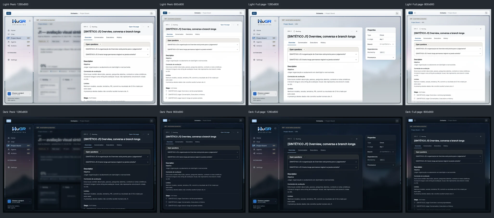

# J1 visual acceptance

Gustavo approved the Projects Board J1 issue workspace on 27 November 2026.

> Agora sim, aprovo o visual do J1.

The approved preview used the synthetic issue `UXV-2` on the real Orchestra web client and isolated Board API. The review covered peek and full page in light and dark at 1280×800 and 800×900. It included the native Orchestra type scale, spacing and hierarchy, the Properties panel and long branch handling.

The preview source was [`5ebe72224437`](https://github.com/gustavomhss/hugr-orchestra/commit/5ebe72224437bd1d9d189e4def58646b845272fd). Its [Board browser tests](https://github.com/gustavomhss/hugr-orchestra/actions/runs/46083017718) and [app typecheck](https://github.com/gustavomhss/hugr-orchestra/actions/runs/46083021713) passed. The visual approval applies to that preview. The PR carries the Actions results for the integration into `dev`.
