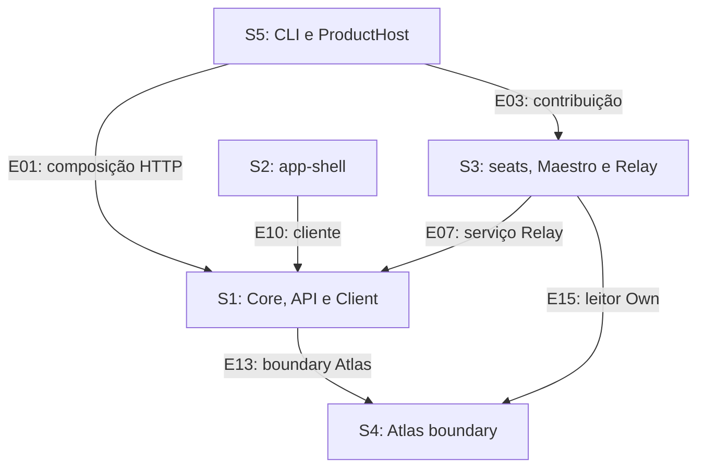

# Grafo estático de contratos e impactos S1–S5

**Candidato público para a coordenação.** Foram rastreados **20 nós**, **17 relações sustentadas por fontes** e **7 impactos inferidos**. As relações observadas são 13 dependências de importação/composição/geração do produto, 2 relações de dispatch HTTP e 2 interfaces de navegação de conhecimento. Nenhum teste, CI, consumidor, ferramenta nativa do produto ou chamada HTTP foi executado.

Código e árvore: `1cde2ff7a71bcf7aecb5d030917b577165135d38`. Protocolo: `ee2521a5b966bd505cc95bd1c733e09e12f33531`. Prompts: `d2d985c28947c7f984a36b07ad34ede3d4d2d6b4`. A autoria começou após o freeze `3d9a515f264a7938c764d37532bc42ad6005fc47`. Os corpos e SHAs dos trechos decisivos estão em `evidence-excerpts-B.json`; os 53 blobs lidos, com escopo integral ou parcial, estão em `sources-B.json`. O grafo verificável é `contracts.json`.

## O que o grafo demonstra

A cadeia CLI → API/Core é visível: `serve.ts` importa `createRoutes`, fornece contribuições de `ProductHost`, e Server aplica `Host.merge` ao grafo de serviços. Essa composição liga S5 a S1 e S3. [B-S02](https://github.com/gustavomhss/hugr-orchestra/blob/1cde2ff7a71bcf7aecb5d030917b577165135d38/apps/cli/src/commands/handlers/serve.ts), [B-S03](https://github.com/gustavomhss/hugr-orchestra/blob/1cde2ff7a71bcf7aecb5d030917b577165135d38/packages/server/src/routes.ts), [B-S04](https://github.com/gustavomhss/hugr-orchestra/blob/1cde2ff7a71bcf7aecb5d030917b577165135d38/packages/core/src/host.ts), [B-S05](https://github.com/gustavomhss/hugr-orchestra/blob/1cde2ff7a71bcf7aecb5d030917b577165135d38/apps/cli/src/host.ts), [B-S06](https://github.com/gustavomhss/hugr-orchestra/blob/1cde2ff7a71bcf7aecb5d030917b577165135d38/modules/maestro/coordination/src/v2/seats.ts)

A cadeia de seats chega ao Relay por uma contribuição do Maestro. `MaestroSeatsV2.contribution` inclui o node do workflow host; o host adquire a sessão de autoridade e chama a porta `WorkflowRelayV2.publication`. Essa porta depende do serviço Relay em Core e abre o store de authoring com a identidade do projeto. Seats, host e authoring são S3; o adaptador `packages/core/src/relay.ts` é S1. [B-S06](https://github.com/gustavomhss/hugr-orchestra/blob/1cde2ff7a71bcf7aecb5d030917b577165135d38/modules/maestro/coordination/src/v2/seats.ts), [B-S08](https://github.com/gustavomhss/hugr-orchestra/blob/1cde2ff7a71bcf7aecb5d030917b577165135d38/modules/maestro/coordination/src/v2/workflow/host.ts), [B-S09](https://github.com/gustavomhss/hugr-orchestra/blob/1cde2ff7a71bcf7aecb5d030917b577165135d38/modules/maestro/coordination/src/v2/workflow/relay.ts), [B-S10](https://github.com/gustavomhss/hugr-orchestra/blob/1cde2ff7a71bcf7aecb5d030917b577165135d38/modules/relay/src/authoring/store.ts), [B-S11](https://github.com/gustavomhss/hugr-orchestra/blob/1cde2ff7a71bcf7aecb5d030917b577165135d38/packages/core/src/relay.ts)

O cliente tem rotas Atlas geradas que correspondem ao `AtlasGroup` do Protocol. Server registra `AtlasHandler`, que resolve a Location e chama `Atlas.open` em Core; Core importa a superfície pública do boundary Atlas. O manifesto aponta para arquivos gerados, e a receita mapeia a superfície para a fonte de S4. **A equivalência do JavaScript gerado com essa fonte permanece UNKNOWN**: não foi inspecionado o corpo executável nem executada a geração. [B-S17](https://github.com/gustavomhss/hugr-orchestra/blob/1cde2ff7a71bcf7aecb5d030917b577165135d38/packages/client/src/contract.ts), [B-S19](https://github.com/gustavomhss/hugr-orchestra/blob/1cde2ff7a71bcf7aecb5d030917b577165135d38/packages/protocol/src/api.ts), [B-S20](https://github.com/gustavomhss/hugr-orchestra/blob/1cde2ff7a71bcf7aecb5d030917b577165135d38/packages/protocol/src/groups/atlas.ts), [B-S21](https://github.com/gustavomhss/hugr-orchestra/blob/1cde2ff7a71bcf7aecb5d030917b577165135d38/packages/client/src/generated/client.ts), [B-S22](https://github.com/gustavomhss/hugr-orchestra/blob/1cde2ff7a71bcf7aecb5d030917b577165135d38/packages/server/src/handlers/atlas.ts), [B-S23](https://github.com/gustavomhss/hugr-orchestra/blob/1cde2ff7a71bcf7aecb5d030917b577165135d38/packages/core/src/atlas.ts), [B-S15](https://github.com/gustavomhss/hugr-orchestra/blob/1cde2ff7a71bcf7aecb5d030917b577165135d38/modules/atlas/boundary/package.json), [B-S16](https://github.com/gustavomhss/hugr-orchestra/blob/1cde2ff7a71bcf7aecb5d030917b577165135d38/modules/atlas/boundary/script/build.ts), [B-S24](https://github.com/gustavomhss/hugr-orchestra/blob/1cde2ff7a71bcf7aecb5d030917b577165135d38/modules/atlas/packages/adapter-io/src/surface/index.ts), [B-S25](https://github.com/gustavomhss/hugr-orchestra/blob/1cde2ff7a71bcf7aecb5d030917b577165135d38/modules/atlas/boundary/src/generated/surface.d.ts), [B-S37](https://github.com/gustavomhss/hugr-orchestra/blob/1cde2ff7a71bcf7aecb5d030917b577165135d38/packages/server/src/handlers.ts)

A fronteira S2 → S1 também é concreta: `app-shell/utils/server.ts` importa `Orchestra` e chama `Orchestra.make`; os barrels de Client reexportam o módulo gerado. O cast para `ServerApi` não prova paridade. [B-S26](https://github.com/gustavomhss/hugr-orchestra/blob/1cde2ff7a71bcf7aecb5d030917b577165135d38/packages/app-shell/src/utils/server.ts), [B-S27](https://github.com/gustavomhss/hugr-orchestra/blob/1cde2ff7a71bcf7aecb5d030917b577165135d38/packages/client/src/index.ts), [B-S28](https://github.com/gustavomhss/hugr-orchestra/blob/1cde2ff7a71bcf7aecb5d030917b577165135d38/packages/client/src/generated/index.ts), [B-S21](https://github.com/gustavomhss/hugr-orchestra/blob/1cde2ff7a71bcf7aecb5d030917b577165135d38/packages/client/src/generated/client.ts)

## Semântica das relações

- **build:** consumidor → módulo, tipo, contrato ou fonte exigida por uma importação ou receita de geração declarada. Aqui são dependências do **produto**. Não são declarações de `build_dependencies` de artefatos Genesis.
- **call:** caller ou contrato de dispatch → contrato chamado, como escrito na fonte. As rotas HTTP não foram invocadas.
- **navigation:** interface de descoberta ou referência → informação alcançável por leitura/resolução explícita. Um vínculo navegável não implica rebuild.
- **impact:** contrato/fonte alterado → consumidor potencialmente afetado. Todas essas arestas são inferências estáticas delimitadas; não há worklist executada nem fechamento transitivo comprovado.

Essas distinções seguem GO-I4, GO-I5 e a exigência de separar build e navegação na integração. Não se inferiu cobertura semântica a partir de imports, contagens ou hashes. [B-P02](https://github.com/gustavomhss/hugr-orchestra/blob/ee2521a5b966bd505cc95bd1c733e09e12f33531/.orchestra/skills/execute-genesis/references/integration.md), [B-P03](https://github.com/gustavomhss/hugr-orchestra/blob/ee2521a5b966bd505cc95bd1c733e09e12f33531/.orchestra/skills/execute-genesis/references/principles.md)

## Visão das fronteiras entre fatias

O diagrama abaixo resume **somente dependências de produto** já descritas. Os números remetem às arestas detalhadas; ele não representa a execução de uma integração.

### Ownership dos nós

O ownership foi calculado por `exact_file > longest_directory_prefix > fallback`, com fronteiras de diretório terminadas em barra. O domínio vem do caminho no baseline, não de palavras como “Atlas” ou “Relay”. [B-P01](https://github.com/gustavomhss/hugr-orchestra/blob/ee2521a5b966bd505cc95bd1c733e09e12f33531/.orchestra/skills/execute-genesis/references/parallel-partition.json)

| Nó | Dono | Caminho âncora | Regra aplicada |
| --- | --- | --- | --- |
| cli_serve | S5 | `apps/cli/src/commands/handlers/serve.ts` | `apps/cli/` |
| cli_host | S5 | `apps/cli/src/host.ts` | `apps/cli/` |
| api_routes | S1 | `packages/server/src/routes.ts` | `packages/server/` |
| core_host | S1 | `packages/core/src/host.ts` | `packages/core/` |
| maestro_seats | S3 | `modules/maestro/coordination/src/v2/seats.ts` | `modules/maestro/` |
| workflow_host | S3 | `modules/maestro/coordination/src/v2/workflow/host.ts` | `modules/maestro/` |
| relay_publication | S3 | `modules/maestro/coordination/src/v2/workflow/relay.ts` | `modules/maestro/` |
| core_relay | S1 | `packages/core/src/relay.ts` | `packages/core/` |
| relay_store | S3 | `modules/relay/src/authoring/store.ts` | `modules/relay/` |
| atlas_tool | S3 | `modules/maestro/coordination/src/v2/tools/atlas.ts` | `modules/maestro/` |
| atlas_reader | S3 | `modules/maestro/coordination/src/v2/atlas-source.ts` | `modules/maestro/` |
| atlas_host_context | S4 | `modules/atlas/packages/retrieval/src/host-context.ts` | `modules/atlas/` |
| atlas_boundary | S4 | `modules/atlas/boundary/package.json` | `modules/atlas/` |
| client_contract | S1 | `packages/client/src/contract.ts` | `packages/client/` |
| protocol_api | S1 | `packages/protocol/src/api.ts` | `packages/protocol/` |
| client | S1 | `packages/client/src/generated/client.ts` | `packages/client/` |
| core_atlas | S1 | `packages/core/src/atlas.ts` | `packages/core/` |
| atlas_surface | S4 | `modules/atlas/packages/adapter-io/src/surface/index.ts` | `modules/atlas/` |
| ui_adapter | S2 | `packages/app-shell/src/utils/server.ts` | `packages/app-shell/` |
| workflow_knowledge | S3 | `modules/maestro/coordination/src/v2/workflow/knowledge.ts` | `modules/maestro/` |

## Relações observadas em fonte

Cada aresta tem direção, mecanismo, fronteira, limite, impacto e controle pendente em JSON. Os links abaixo são os blobs efetivamente lidos, no pin indicado. Os SHAs completos estão no apêndice e no JSON de cada aresta.

### B-E01 — build: cli_serve → api_routes

**Mecanismo:** serve.ts importa createRoutes e o fornece a HttpRouter.serve; routes.ts declara createRoutes e monta HttpApiBuilder.layer.

**Fronteira:** S5 CLI → S1 Server. **Limite:** Import/chamada escrita em fonte; nenhum servidor foi iniciado.

**Impacto inferido:** Mudanças em Options/createRoutes podem afetar o comando serve e a inicialização HTTP.

**Controle ainda necessário — NOT_RUN:** Rever delta de assinatura e executar composição/arranque no candidato exato somente pela coordenação.

**Fontes:** [B-S01](https://github.com/gustavomhss/hugr-orchestra/blob/1cde2ff7a71bcf7aecb5d030917b577165135d38/apps/cli/package.json), [B-S02](https://github.com/gustavomhss/hugr-orchestra/blob/1cde2ff7a71bcf7aecb5d030917b577165135d38/apps/cli/src/commands/handlers/serve.ts), [B-S03](https://github.com/gustavomhss/hugr-orchestra/blob/1cde2ff7a71bcf7aecb5d030917b577165135d38/packages/server/src/routes.ts), [B-S34](https://github.com/gustavomhss/hugr-orchestra/blob/1cde2ff7a71bcf7aecb5d030917b577165135d38/packages/server/package.json).

### B-E02 — build: cli_serve → cli_host

**Mecanismo:** hosts() retorna ProductHost.contributions(AppDockSocket.fromEnv()); o resultado é passado como host à criação das rotas.

**Fronteira:** S5 command → composição S5. **Limite:** Dock é condicional ao canal recebido; nenhum canal foi aberto.

**Impacto inferido:** Mudança na lista/ordem de contribuições altera a composição entregue por serve.

**Controle ainda necessário — NOT_RUN:** Conferir lista e ordem de contribuições e cenário com/sem canal Dock.

**Fontes:** [B-S02](https://github.com/gustavomhss/hugr-orchestra/blob/1cde2ff7a71bcf7aecb5d030917b577165135d38/apps/cli/src/commands/handlers/serve.ts), [B-S05](https://github.com/gustavomhss/hugr-orchestra/blob/1cde2ff7a71bcf7aecb5d030917b577165135d38/apps/cli/src/host.ts).

### B-E03 — build: cli_host → maestro_seats

**Mecanismo:** ProductHost importa @orchestra/maestro/v2/seats e inclui MaestroSeatsV2.contribution; manifesto mapeia esse export para v2/seats.ts.

**Fronteira:** S5 → S3; injeção explícita de contribuição do produto. **Limite:** O comentário de seats.ts registra que roster/playbooks podem não carregar no CLI standalone; composição declarada não comprova disponibilidade.

**Impacto inferido:** Mudanças em contribuição, roster e skills podem afetar agentes/ferramentas expostos pelo host.

**Controle ainda necessário — NOT_RUN:** Conferir recursos embarcados e efeitos da indisponibilidade do roster no build escolhido.

**Fontes:** [B-S05](https://github.com/gustavomhss/hugr-orchestra/blob/1cde2ff7a71bcf7aecb5d030917b577165135d38/apps/cli/src/host.ts), [B-S06](https://github.com/gustavomhss/hugr-orchestra/blob/1cde2ff7a71bcf7aecb5d030917b577165135d38/modules/maestro/coordination/src/v2/seats.ts), [B-S32](https://github.com/gustavomhss/hugr-orchestra/blob/1cde2ff7a71bcf7aecb5d030917b577165135d38/modules/maestro/coordination/package.json).

### B-E04 — build: api_routes → core_host

**Mecanismo:** routes.ts importa Host de @orchestra/core/host, cujo export público ./host aponta para ./src/host.ts. makeRoutes chama Host.merge(options.host ?? []) e aplica nodes, replacements, locationNodes e references ao grafo de serviços.

**Fronteira:** S1 Server → S1 Core; aplica contribuições declaradas pela composição da aplicação (cadeia S5→S3 rastreada nas E02/E03). **Limite:** Host.merge contém validações síncronas para IDs/nós duplicados e nós reservados; estas recusas não foram executadas.

**Impacto inferido:** Contrato Host.Contribution é ponto de impacto para todos os módulos selecionados que o entregam.

**Controle ainda necessário — NOT_RUN:** Exercitar colisões de IDs/nós e preservação do SessionExecution global no candidato integrado.

**Fontes:** [B-S03](https://github.com/gustavomhss/hugr-orchestra/blob/1cde2ff7a71bcf7aecb5d030917b577165135d38/packages/server/src/routes.ts), [B-S04](https://github.com/gustavomhss/hugr-orchestra/blob/1cde2ff7a71bcf7aecb5d030917b577165135d38/packages/core/src/host.ts), [B-S31](https://github.com/gustavomhss/hugr-orchestra/blob/1cde2ff7a71bcf7aecb5d030917b577165135d38/packages/core/package.json).

### B-E05 — build: maestro_seats → workflow_host

**Mecanismo:** seats.ts projeta o catálogo Seats nos agentes e adiciona MaestroWorkflowHostV2.node em contribution.nodes.

**Fronteira:** Dentro de S3; a contribuição depois atravessa o Host S1. **Limite:** Não afirma que todos os seats estejam habilitados ou que um workflow tenha rodado.

**Impacto inferido:** Mudanças no node ou catálogo podem afetar disponibilidade e governança das tarefas do Maestro.

**Controle ainda necessário — NOT_RUN:** Conferir catálogo/nós e exercer ao menos um caso autorizado de seat pelo host real.

**Fontes:** [B-S06](https://github.com/gustavomhss/hugr-orchestra/blob/1cde2ff7a71bcf7aecb5d030917b577165135d38/modules/maestro/coordination/src/v2/seats.ts), [B-S07](https://github.com/gustavomhss/hugr-orchestra/blob/1cde2ff7a71bcf7aecb5d030917b577165135d38/modules/maestro/coordination/src/seats/index.ts), [B-S08](https://github.com/gustavomhss/hugr-orchestra/blob/1cde2ff7a71bcf7aecb5d030917b577165135d38/modules/maestro/coordination/src/v2/workflow/host.ts).

### B-E06 — build: workflow_host → relay_publication

**Mecanismo:** WorkflowHost.within obtém a authority Session e Relay.Service, então chama WorkflowRelayV2.publication(relay, authority, {store,seats,atlas}).

**Fronteira:** S3 workflow host → porta S3 com serviços S1. **Limite:** O código verifica linhagem/placement antes da chamada; eficácia em runtime permanece UNKNOWN.

**Impacto inferido:** Mudança em placement/publication pode invalidar a vinculação de plano de um seat ao Relay correto.

**Controle ainda necessário — NOT_RUN:** Exercitar sessão ausente, placement incompatível e porta de publicação no candidato fixo.

**Fontes:** [B-S08](https://github.com/gustavomhss/hugr-orchestra/blob/1cde2ff7a71bcf7aecb5d030917b577165135d38/modules/maestro/coordination/src/v2/workflow/host.ts), [B-S09](https://github.com/gustavomhss/hugr-orchestra/blob/1cde2ff7a71bcf7aecb5d030917b577165135d38/modules/maestro/coordination/src/v2/workflow/relay.ts).

### B-E07 — build: relay_publication → core_relay

**Mecanismo:** A porta depende de Relay.Interface e adquire Relay.Service por LocationServiceMap; core/relay.ts define paths/currentStep/transition e o serviço Location-scoped.

**Fronteira:** S3 → S1; serviço core Relay pertence a S1 pelo path, não pelo nome. **Limite:** CurrentStep/transition são declarados; nenhuma transição ou avaliação foi executada.

**Impacto inferido:** Mudanças em paths/Interface/placement podem afetar a publicação e a retomada do host de workflows.

**Controle ainda necessário — NOT_RUN:** Validar identidade de projeto/Location e compatibilidade do serviço usado pelos workflows.

**Fontes:** [B-S09](https://github.com/gustavomhss/hugr-orchestra/blob/1cde2ff7a71bcf7aecb5d030917b577165135d38/modules/maestro/coordination/src/v2/workflow/relay.ts), [B-S11](https://github.com/gustavomhss/hugr-orchestra/blob/1cde2ff7a71bcf7aecb5d030917b577165135d38/packages/core/src/relay.ts).

### B-E08 — build: relay_publication → relay_store

**Mecanismo:** publication.use abre AuthoringStore.open(service.paths.root, placement.projectID) e expõe somente get/version/documents à leitura.

**Fronteira:** Dentro de S3; boundary entre porta do host e store de authoring. **Limite:** A checagem basename(root) versus projectID está na fonte; isolamento real e integridade do banco não foram exercitados.

**Impacto inferido:** Mudanças em get/version/documents ou escopo de abertura afetam resolução das publicações ligadas aos workflows.

**Controle ainda necessário — NOT_RUN:** Exercitar aquisição falha, projeto incompatível e resolução de versão exata.

**Fontes:** [B-S09](https://github.com/gustavomhss/hugr-orchestra/blob/1cde2ff7a71bcf7aecb5d030917b577165135d38/modules/maestro/coordination/src/v2/workflow/relay.ts), [B-S10](https://github.com/gustavomhss/hugr-orchestra/blob/1cde2ff7a71bcf7aecb5d030917b577165135d38/modules/relay/src/authoring/store.ts), [B-S35](https://github.com/gustavomhss/hugr-orchestra/blob/1cde2ff7a71bcf7aecb5d030917b577165135d38/modules/relay/package.json).

### B-E09 — build: client_contract → protocol_api

**Mecanismo:** ClientApi usa makeDefaultApi; build.ts compila ClientApi e grava generated/generated-effect. A API agrega AtlasGroup.

**Fronteira:** S1 Client/codegen → S1 Protocol; dependência de geração. **Limite:** Receita lida; generate/check:generated não foram executados. Dependência de geração não é dependência runtime em Server/Core.

**Impacto inferido:** Alterar endpoint/grupo/shape pode exigir regeneração do cliente e revalidação do contrato.

**Controle ainda necessário — NOT_RUN:** Conferir geração do cliente no commit integrado e igualdade das saídas antes de reaproveitar provas.

**Fontes:** [B-S17](https://github.com/gustavomhss/hugr-orchestra/blob/1cde2ff7a71bcf7aecb5d030917b577165135d38/packages/client/src/contract.ts), [B-S18](https://github.com/gustavomhss/hugr-orchestra/blob/1cde2ff7a71bcf7aecb5d030917b577165135d38/packages/client/script/build.ts), [B-S19](https://github.com/gustavomhss/hugr-orchestra/blob/1cde2ff7a71bcf7aecb5d030917b577165135d38/packages/protocol/src/api.ts), [B-S33](https://github.com/gustavomhss/hugr-orchestra/blob/1cde2ff7a71bcf7aecb5d030917b577165135d38/packages/client/package.json).

### B-E10 — build: ui_adapter → client

**Mecanismo:** app-shell/utils/server.ts importa Orchestra de @orchestra/client e chama Orchestra.make; index.ts e generated/index.ts reexportam o módulo client.

**Fronteira:** S2 app-shell → S1 Client. **Limite:** O adaptador local faz cast para ServerApi; comentário aponta verificação de paridade, não executada nesta auditoria.

**Impacto inferido:** Mudanças em métodos/inputs do cliente podem afetar o adaptador e fluxos da UI.

**Controle ainda necessário — NOT_RUN:** Validar paridade do adaptador e consumo do contrato alterado; não concluir pela presença do cast.

**Fontes:** [B-S26](https://github.com/gustavomhss/hugr-orchestra/blob/1cde2ff7a71bcf7aecb5d030917b577165135d38/packages/app-shell/src/utils/server.ts), [B-S27](https://github.com/gustavomhss/hugr-orchestra/blob/1cde2ff7a71bcf7aecb5d030917b577165135d38/packages/client/src/index.ts), [B-S28](https://github.com/gustavomhss/hugr-orchestra/blob/1cde2ff7a71bcf7aecb5d030917b577165135d38/packages/client/src/generated/index.ts), [B-S21](https://github.com/gustavomhss/hugr-orchestra/blob/1cde2ff7a71bcf7aecb5d030917b577165135d38/packages/client/src/generated/client.ts), [B-S29](https://github.com/gustavomhss/hugr-orchestra/blob/1cde2ff7a71bcf7aecb5d030917b577165135d38/packages/app-shell/package.json).

### B-E11 — call: client → protocol_api

**Mecanismo:** Cliente atlas.snapshot/own envia GET /api/atlas/snapshot e /api/atlas/own; AtlasGroup declara exatamente essas rotas, LocationQuery e respostas.

**Fronteira:** S1 Client → contrato HTTP S1; fronteira de transporte. **Limite:** É chamada HTTP declarada, não importação de Client para Core/Server. Nenhuma requisição foi enviada.

**Impacto inferido:** Alterar método/path/query/shape/erros pode romper client/API mesmo com compilação isolada.

**Controle ainda necessário — NOT_RUN:** Consumir as rotas reais no candidato, incluindo erro de Location/auth e ausência do store.

**Fontes:** [B-S21](https://github.com/gustavomhss/hugr-orchestra/blob/1cde2ff7a71bcf7aecb5d030917b577165135d38/packages/client/src/generated/client.ts), [B-S20](https://github.com/gustavomhss/hugr-orchestra/blob/1cde2ff7a71bcf7aecb5d030917b577165135d38/packages/protocol/src/groups/atlas.ts), [B-S19](https://github.com/gustavomhss/hugr-orchestra/blob/1cde2ff7a71bcf7aecb5d030917b577165135d38/packages/protocol/src/api.ts).

### B-E12 — call: protocol_api → core_atlas

**Mecanismo:** AtlasGroup usa server.atlas; handlers.ts inclui AtlasHandler e routes.ts fornece handlers. AtlasHandler registra atlas.own/snapshot e chama Atlas.open com storeRoot e project.id da Location.

**Fronteira:** S1 Protocol/Server → adaptador Core S1. **Limite:** Ligação estática por grupo/handlers; não demonstra middleware autorizado ou coerência observada.

**Impacto inferido:** Mudanças de resolução de Location/storeRoot podem alterar a origem de knowledge entregue ao cliente.

**Controle ainda necessário — NOT_RUN:** Consumidor HTTP deve conferir project/store binding e recusa de erro sem confundir {state:empty} com dados válidos.

**Fontes:** [B-S19](https://github.com/gustavomhss/hugr-orchestra/blob/1cde2ff7a71bcf7aecb5d030917b577165135d38/packages/protocol/src/api.ts), [B-S20](https://github.com/gustavomhss/hugr-orchestra/blob/1cde2ff7a71bcf7aecb5d030917b577165135d38/packages/protocol/src/groups/atlas.ts), [B-S37](https://github.com/gustavomhss/hugr-orchestra/blob/1cde2ff7a71bcf7aecb5d030917b577165135d38/packages/server/src/handlers.ts), [B-S03](https://github.com/gustavomhss/hugr-orchestra/blob/1cde2ff7a71bcf7aecb5d030917b577165135d38/packages/server/src/routes.ts), [B-S22](https://github.com/gustavomhss/hugr-orchestra/blob/1cde2ff7a71bcf7aecb5d030917b577165135d38/packages/server/src/handlers/atlas.ts), [B-S23](https://github.com/gustavomhss/hugr-orchestra/blob/1cde2ff7a71bcf7aecb5d030917b577165135d38/packages/core/src/atlas.ts).

### B-E13 — build: core_atlas → atlas_boundary

**Mecanismo:** Core importa openSurface de @orchestra/atlas-boundary/surface; o manifesto exporta generated/surface.js e surface.d.ts, cuja declaração inclui openSurface/own/snapshot.

**Fronteira:** S1 → S4; boundary empacotada. **Limite:** A declaração gerada foi lida; o corpo JS gerado não foi inspecionado nem comparado à receita. Não se afirma equivalência executável.

**Impacto inferido:** Mudanças de export, declaração ou implementação gerada podem afetar API/knowledge no Core.

**Controle ainda necessário — NOT_RUN:** Rever os bytes gerados e executar check:generated/consumo somente no candidato autorizado pela coordenação.

**Fontes:** [B-S23](https://github.com/gustavomhss/hugr-orchestra/blob/1cde2ff7a71bcf7aecb5d030917b577165135d38/packages/core/src/atlas.ts), [B-S15](https://github.com/gustavomhss/hugr-orchestra/blob/1cde2ff7a71bcf7aecb5d030917b577165135d38/modules/atlas/boundary/package.json), [B-S25](https://github.com/gustavomhss/hugr-orchestra/blob/1cde2ff7a71bcf7aecb5d030917b577165135d38/modules/atlas/boundary/src/generated/surface.d.ts), [B-S31](https://github.com/gustavomhss/hugr-orchestra/blob/1cde2ff7a71bcf7aecb5d030917b577165135d38/packages/core/package.json).

### B-E14 — build: atlas_boundary → atlas_surface

**Mecanismo:** A receita mapeia surface para adapter-io/src/surface/index.ts; essa fonte declara openSurface e own(scope) sobre composeRuntime.

**Fronteira:** Dentro de S4; export gerado → fonte da receita declarada. **Limite:** Manifesto, receita que escreve src/generated e fonte estão lidos; paridade com generated/surface.js é UNKNOWN.

**Impacto inferido:** Mudanças nesta fonte/receita podem requerer rebuild do boundary consumido por S1 e nova prova de integração.

**Controle ainda necessário — NOT_RUN:** Gerar/verificar bundle e invalidar provas do boundary caso os bytes/receita mudem.

**Fontes:** [B-S16](https://github.com/gustavomhss/hugr-orchestra/blob/1cde2ff7a71bcf7aecb5d030917b577165135d38/modules/atlas/boundary/script/build.ts), [B-S24](https://github.com/gustavomhss/hugr-orchestra/blob/1cde2ff7a71bcf7aecb5d030917b577165135d38/modules/atlas/packages/adapter-io/src/surface/index.ts), [B-S15](https://github.com/gustavomhss/hugr-orchestra/blob/1cde2ff7a71bcf7aecb5d030917b577165135d38/modules/atlas/boundary/package.json).

### B-E15 — build: atlas_reader → atlas_host_context

**Mecanismo:** MaestroAtlasSourceV2 importa inspectOwnSnapshot/verifyHostContext do boundary. Receita boundary aponta para retrieval/src/host-context.ts, que declara essas funções.

**Fronteira:** S3 → S4 pela API pública empacotada. **Limite:** Fonte/receita/export observados; paridade do bundle boundary.js não foi executada. Chamadas internas a Git/FS foram somente lidas.

**Impacto inferido:** Mudanças na verificação do snapshot/contexto podem afetar as unidades aceitas pelos seats e Maestro.

**Controle ainda necessário — NOT_RUN:** Verificar geração do boundary e exercer recusas no host real sem importar snapshots desta auditoria.

**Fontes:** [B-S13](https://github.com/gustavomhss/hugr-orchestra/blob/1cde2ff7a71bcf7aecb5d030917b577165135d38/modules/maestro/coordination/src/v2/atlas-source.ts), [B-S14](https://github.com/gustavomhss/hugr-orchestra/blob/1cde2ff7a71bcf7aecb5d030917b577165135d38/modules/atlas/packages/retrieval/src/host-context.ts), [B-S15](https://github.com/gustavomhss/hugr-orchestra/blob/1cde2ff7a71bcf7aecb5d030917b577165135d38/modules/atlas/boundary/package.json), [B-S16](https://github.com/gustavomhss/hugr-orchestra/blob/1cde2ff7a71bcf7aecb5d030917b577165135d38/modules/atlas/boundary/script/build.ts).

### B-E16 — navigation: atlas_tool → atlas_reader

**Mecanismo:** atlas_context distingue action=catalog, unit e anchor; catálogo expõe metadados de IDs, action=unit entrega a unidade exata por MaestroAtlasSourceV2.unit.

**Fronteira:** S3 leitor do seat/Maestro → catálogo/unidade verificada; leitura é mediada por boundary S4. **Limite:** Navegação progressiva por ID, não aresta de build entre unidades. Os IDs e corpos de unidades concretas não foram consultados.

**Impacto inferido:** Uma alteração de IDs/catalog pode invalidar referências de navegação; não basta para inferir rebuild de corpos independentes.

**Controle ainda necessário — NOT_RUN:** Consumidor Atlas-only deve passar catálogo→unidade rasa/profunda com budgets e erro explícito para ID ausente.

**Fontes:** [B-S12](https://github.com/gustavomhss/hugr-orchestra/blob/1cde2ff7a71bcf7aecb5d030917b577165135d38/modules/maestro/coordination/src/v2/tools/atlas.ts), [B-S13](https://github.com/gustavomhss/hugr-orchestra/blob/1cde2ff7a71bcf7aecb5d030917b577165135d38/modules/maestro/coordination/src/v2/atlas-source.ts).

### B-E18 — navigation: relay_publication → workflow_knowledge

**Mecanismo:** publication.knowledge encaminha reference+authorSessionID a WorkflowKnowledgeV2.resolve; o resolver busca um anchor de atlas_context na sessão autora e readquire as mesmas unidades.

**Fronteira:** S3 publicação de workflow → referência de Knowledge ligada ao consumo S4; história de sessão S1 é entrada. **Limite:** Referência é navegação com validação de identidade/digest; não é autoridade executável nem aceite. Nenhum histórico foi obtido.

**Impacto inferido:** Drift das unidades, mudança de sessão/projeto ou digest pode invalidar a referência usada pelo workflow.

**Controle ainda necessário — NOT_RUN:** Exercitar anchor ausente/duplicado, source drift e binding incompatível através da porta real.

**Fontes:** [B-S09](https://github.com/gustavomhss/hugr-orchestra/blob/1cde2ff7a71bcf7aecb5d030917b577165135d38/modules/maestro/coordination/src/v2/workflow/relay.ts), [B-S30](https://github.com/gustavomhss/hugr-orchestra/blob/1cde2ff7a71bcf7aecb5d030917b577165135d38/modules/maestro/coordination/src/v2/workflow/knowledge.ts), [B-S12](https://github.com/gustavomhss/hugr-orchestra/blob/1cde2ff7a71bcf7aecb5d030917b577165135d38/modules/maestro/coordination/src/v2/tools/atlas.ts).

## Impacto: direção inversa e escopo delimitado

A tabela não afirma que cada mudança sempre invalida tudo. Ela indica consumidores que devem ser examinados quando o contrato citado muda. A coordenação precisa reconciliar o delta real, a receita e os inputs dos artefatos de conhecimento. Um resultado de observação desconhecido não equivale a zero afetados.

| ID | Fonte alterada → consumidor potencial | Razão | Base |
| --- | --- | --- | --- |
| B-I01 | protocol_api → client | Mudança de endpoint/shape no Protocol pode requerer regeneração e invalidate os contratos do client. | B-E09, B-E11 |
| B-I02 | client → ui_adapter | Métodos/inputs/erros diferentes podem afetar o adaptador app-shell. | B-E10 |
| B-I03 | core_host → cli_host | Mudança em Host.Contribution/merge pode alterar aceitação das contribuições compostas pelo CLI. | B-E03, B-E04 |
| B-I04 | relay_store → workflow_host | Mudança de versão/documento/escopo do store pode afetar resolução de publicação no host. | B-E06, B-E08 |
| B-I05 | atlas_surface → core_atlas | Mudança na superfície Atlas ou receita pode propagar ao boundary, Core e respostas HTTP. | B-E13, B-E14, B-E12 |
| B-I06 | atlas_host_context → workflow_knowledge | Mudança da validação/contexto ou das unidades aceitas pode invalidar anchors de workflows. | B-E15, B-E16, B-E18 |
| B-I07 | maestro_seats → cli_serve | Mudança de roster/contribuição/recursos pode alterar agentes disponíveis no produto servido pelo CLI. | B-E03, B-E05, B-E02 |

## Lacunas materiais e limites

| Gap | Estado verificado | Próximo controle da coordenação |
| --- | --- | --- |
| B-G01 — Generated executable boundary parity | Core and Maestro import packaged generated Atlas exports. The recipe and public declarations were inspected; executable surface.js/boundary.js equivalence to their source was not established. **UNKNOWN** | Bind exact generated blobs plus recipe in candidate and perform required generation/consumer gates under coordination. |
| B-G02 — Runtime and real consumer behavior | Static wiring does not establish actual successful composition, HTTP delivery, Host refusals, coherent reads, rollback or use of accepted Genesis knowledge. **NOT_RUN** | Select exact handoffs/runtime release and execute missing or invalidated controls under the primary coordination. |
| B-G03 — Complete transitive impact set | The graph covers selected critical boundaries and minimum requested chains; it is not the exhaustive import/call graph of every baseline blob. Impact targets are a lower-bound hypothesis for review, not a calculated worklist. **UNKNOWN** | Use the actual candidate delta and artifact build dependencies to determine affected/preserved knowledge; treat observation failure distinctly from an empty set. |
| B-G04 — Seat resources in the chosen product build | seats.ts explicitly catches lazy roster/skill-root loading and warns if unavailable; its comment identifies standalone CLI resource absence. The selected shipped build's availability was not inspected. **UNKNOWN** | Verify roster/skills/playbooks are packaged and discoverable in the exact integrated build, preserving the native identity and visibility rules. |
| B-G05 — Actual Genesis navigation and knowledge dependency graph | catalog/unit/anchor and reference-resolution interfaces were inspected. No actual accepted S1–S5 knowledge units, private oracles or other-session outputs were read. There are no asserted unit-to-unit navigation/build edges. **UNKNOWN** | Coordination must bind accepted unit IDs and inspect their navigation links separately from build_dependencies, then use an independent Atlas-only consumer. |
| B-G06 — Client generation and app adapter parity | ClientApi generation path and selected HTTP endpoint strings align statically. app-shell adapter casts to ServerApi; the complete generated/client/API/UI parity was not established. **UNKNOWN** | For affected contracts, verify generated bytes and exercise API/adapter parity on the exact candidate; reuse prior proof only if source, recipe, outputs and scope are compatible. |

### Navegação de conhecimento observada e o que falta

`atlas_context` separa catálogo, unidade exata e anchor. A resposta de catálogo descreve unidades; a operação `unit` pede um ID exato. O resolver de workflows procura uma referência originada por `atlas_context` na sessão autora, confere identidade/digest e readquire as mesmas unidades. Essas são relações de navegação e binding previstas pela fonte. [B-S12](https://github.com/gustavomhss/hugr-orchestra/blob/1cde2ff7a71bcf7aecb5d030917b577165135d38/modules/maestro/coordination/src/v2/tools/atlas.ts), [B-S13](https://github.com/gustavomhss/hugr-orchestra/blob/1cde2ff7a71bcf7aecb5d030917b577165135d38/modules/maestro/coordination/src/v2/atlas-source.ts), [B-S30](https://github.com/gustavomhss/hugr-orchestra/blob/1cde2ff7a71bcf7aecb5d030917b577165135d38/modules/maestro/coordination/src/v2/workflow/knowledge.ts)

Nenhum corpo de unidade aceita da campanha nem vínculo entre unidades S1–S5 foi lido. O tipo `VerifiedOwnUnit` carrega `pointers` e `pullReachable`, mas sua presença não comprova um grafo concreto de conhecimento. Por isso não foram criadas arestas entre unidades a partir de nomes, vizinhança, imports do produto ou contagens do inventário. [B-S14](https://github.com/gustavomhss/hugr-orchestra/blob/1cde2ff7a71bcf7aecb5d030917b577165135d38/modules/atlas/packages/retrieval/src/host-context.ts)

### Geração e runtime

O cliente declara uma receita a partir de `ClientApi`; o boundary Atlas declara outra a partir de seus entrypoints de origem. Elas são fontes verificáveis para orientar gates futuros. O estado dos gerados no candidato, a disponibilidade do release de S4, o funcionamento do host e a compatibilidade entre os cinco handoffs continuam sem verificação nesta auditoria. A presença de assinaturas e verificações negativas no código não equivale a observá-las recusando um caso real.

A integração principal deve usar o plano de `verification-plan.json`, reaproveitando provas exatas e compatíveis. O grafo aponta onde um delta pode invalidar essas provas; ele não autoriza ampliar runtime, alterar fatias reservadas ou aceitar a união. [B-P02](https://github.com/gustavomhss/hugr-orchestra/blob/ee2521a5b966bd505cc95bd1c733e09e12f33531/.orchestra/skills/execute-genesis/references/integration.md)

## Identidades das fontes decisivas

Os SHAs são valores fornecidos pelo GitHub MCP. “Parcial” significa que o blob foi obtido e somente trechos selecionados foram examinados; nenhuma cobertura semântica integral é reivindicada por essa leitura.

| ID | Path | Blob SHA | Leitura |
| --- | --- | --- | --- |
| [B-S01](https://github.com/gustavomhss/hugr-orchestra/blob/1cde2ff7a71bcf7aecb5d030917b577165135d38/apps/cli/package.json) | `apps/cli/package.json` | `c9c071a3db4543abab9f02dfd25a494881a23377` | Integral |
| [B-S02](https://github.com/gustavomhss/hugr-orchestra/blob/1cde2ff7a71bcf7aecb5d030917b577165135d38/apps/cli/src/commands/handlers/serve.ts) | `apps/cli/src/commands/handlers/serve.ts` | `f11a2c92019d75847eac7b87d0b762cf944e7c93` | Integral |
| [B-S03](https://github.com/gustavomhss/hugr-orchestra/blob/1cde2ff7a71bcf7aecb5d030917b577165135d38/packages/server/src/routes.ts) | `packages/server/src/routes.ts` | `75b0f9753e4c879767ef186f5003519e2b681025` | Parcial |
| [B-S04](https://github.com/gustavomhss/hugr-orchestra/blob/1cde2ff7a71bcf7aecb5d030917b577165135d38/packages/core/src/host.ts) | `packages/core/src/host.ts` | `a0fc5bc9a36e50315b0ddddf4de3566555711250` | Integral |
| [B-S05](https://github.com/gustavomhss/hugr-orchestra/blob/1cde2ff7a71bcf7aecb5d030917b577165135d38/apps/cli/src/host.ts) | `apps/cli/src/host.ts` | `cc89adc3a11e2bd3e7d779642382ed86dfceab31` | Integral |
| [B-S06](https://github.com/gustavomhss/hugr-orchestra/blob/1cde2ff7a71bcf7aecb5d030917b577165135d38/modules/maestro/coordination/src/v2/seats.ts) | `modules/maestro/coordination/src/v2/seats.ts` | `f27ddca3b35551b16482f7032197af7cba25e3e6` | Integral |
| [B-S07](https://github.com/gustavomhss/hugr-orchestra/blob/1cde2ff7a71bcf7aecb5d030917b577165135d38/modules/maestro/coordination/src/seats/index.ts) | `modules/maestro/coordination/src/seats/index.ts` | `a4f0ecf5b5144f91837571286f91fc552be0c826` | Integral |
| [B-S08](https://github.com/gustavomhss/hugr-orchestra/blob/1cde2ff7a71bcf7aecb5d030917b577165135d38/modules/maestro/coordination/src/v2/workflow/host.ts) | `modules/maestro/coordination/src/v2/workflow/host.ts` | `111dac220a84bdeffe94956244b728b29eb98ea4` | Parcial |
| [B-S09](https://github.com/gustavomhss/hugr-orchestra/blob/1cde2ff7a71bcf7aecb5d030917b577165135d38/modules/maestro/coordination/src/v2/workflow/relay.ts) | `modules/maestro/coordination/src/v2/workflow/relay.ts` | `66c147f58f29334e1cfe541f240c14619a87d05c` | Integral |
| [B-S10](https://github.com/gustavomhss/hugr-orchestra/blob/1cde2ff7a71bcf7aecb5d030917b577165135d38/modules/relay/src/authoring/store.ts) | `modules/relay/src/authoring/store.ts` | `b11d17cd55ffa69a307130a31ab44d01ac7e477d` | Parcial |
| [B-S11](https://github.com/gustavomhss/hugr-orchestra/blob/1cde2ff7a71bcf7aecb5d030917b577165135d38/packages/core/src/relay.ts) | `packages/core/src/relay.ts` | `25fb509203f933a2e8b0f311c3fc8f9476d53e16` | Parcial |
| [B-S12](https://github.com/gustavomhss/hugr-orchestra/blob/1cde2ff7a71bcf7aecb5d030917b577165135d38/modules/maestro/coordination/src/v2/tools/atlas.ts) | `modules/maestro/coordination/src/v2/tools/atlas.ts` | `1989941d868187b7fc264559f0c90d11c9b1c4d3` | Parcial |
| [B-S13](https://github.com/gustavomhss/hugr-orchestra/blob/1cde2ff7a71bcf7aecb5d030917b577165135d38/modules/maestro/coordination/src/v2/atlas-source.ts) | `modules/maestro/coordination/src/v2/atlas-source.ts` | `5388417c92f33c2cfd0d06d58d04446c35631d42` | Parcial |
| [B-S14](https://github.com/gustavomhss/hugr-orchestra/blob/1cde2ff7a71bcf7aecb5d030917b577165135d38/modules/atlas/packages/retrieval/src/host-context.ts) | `modules/atlas/packages/retrieval/src/host-context.ts` | `6c60032a6049e5de89592d9b6aa483207c909598` | Integral |
| [B-S15](https://github.com/gustavomhss/hugr-orchestra/blob/1cde2ff7a71bcf7aecb5d030917b577165135d38/modules/atlas/boundary/package.json) | `modules/atlas/boundary/package.json` | `055b46b9d32d765c3c2dc54468137d031bb3de90` | Integral |
| [B-S16](https://github.com/gustavomhss/hugr-orchestra/blob/1cde2ff7a71bcf7aecb5d030917b577165135d38/modules/atlas/boundary/script/build.ts) | `modules/atlas/boundary/script/build.ts` | `df0a875e47e98e8803e00818d178166d0b1cb8dd` | Integral |
| [B-S17](https://github.com/gustavomhss/hugr-orchestra/blob/1cde2ff7a71bcf7aecb5d030917b577165135d38/packages/client/src/contract.ts) | `packages/client/src/contract.ts` | `1dccaeb657cc106b7a8cba93f5f5c34a8faf8680` | Integral |
| [B-S18](https://github.com/gustavomhss/hugr-orchestra/blob/1cde2ff7a71bcf7aecb5d030917b577165135d38/packages/client/script/build.ts) | `packages/client/script/build.ts` | `99ae2184b9c13f6175d7ba8e3025068bee07ee4f` | Integral |
| [B-S19](https://github.com/gustavomhss/hugr-orchestra/blob/1cde2ff7a71bcf7aecb5d030917b577165135d38/packages/protocol/src/api.ts) | `packages/protocol/src/api.ts` | `40b5b5bd266b8a9bd3893f74d5429bf535dc01d7` | Integral |
| [B-S20](https://github.com/gustavomhss/hugr-orchestra/blob/1cde2ff7a71bcf7aecb5d030917b577165135d38/packages/protocol/src/groups/atlas.ts) | `packages/protocol/src/groups/atlas.ts` | `1ad5dee72e17105d118eef8974cc283b68ea64ce` | Integral |
| [B-S21](https://github.com/gustavomhss/hugr-orchestra/blob/1cde2ff7a71bcf7aecb5d030917b577165135d38/packages/client/src/generated/client.ts) | `packages/client/src/generated/client.ts` | `93cab27e0b902d6e8fbd21d6aaec320a2b9fe09c` | Parcial |
| [B-S22](https://github.com/gustavomhss/hugr-orchestra/blob/1cde2ff7a71bcf7aecb5d030917b577165135d38/packages/server/src/handlers/atlas.ts) | `packages/server/src/handlers/atlas.ts` | `692afb828dc5c896339adfebbb5e33ef39876347` | Integral |
| [B-S23](https://github.com/gustavomhss/hugr-orchestra/blob/1cde2ff7a71bcf7aecb5d030917b577165135d38/packages/core/src/atlas.ts) | `packages/core/src/atlas.ts` | `f6718654785fb155e1bb1b2acb7e9985478b983b` | Integral |
| [B-S24](https://github.com/gustavomhss/hugr-orchestra/blob/1cde2ff7a71bcf7aecb5d030917b577165135d38/modules/atlas/packages/adapter-io/src/surface/index.ts) | `modules/atlas/packages/adapter-io/src/surface/index.ts` | `cf531a1cba71737a453ef43a4d8b0af9c5914189` | Parcial |
| [B-S25](https://github.com/gustavomhss/hugr-orchestra/blob/1cde2ff7a71bcf7aecb5d030917b577165135d38/modules/atlas/boundary/src/generated/surface.d.ts) | `modules/atlas/boundary/src/generated/surface.d.ts` | `7614ff6a04ff82b76ed68836a843d7232fa8cd43` | Parcial |
| [B-S26](https://github.com/gustavomhss/hugr-orchestra/blob/1cde2ff7a71bcf7aecb5d030917b577165135d38/packages/app-shell/src/utils/server.ts) | `packages/app-shell/src/utils/server.ts` | `542e992958dca3993e633babd881c5a7e8407c66` | Integral |
| [B-S27](https://github.com/gustavomhss/hugr-orchestra/blob/1cde2ff7a71bcf7aecb5d030917b577165135d38/packages/client/src/index.ts) | `packages/client/src/index.ts` | `b65f3f982384824273b9641df98671bc4392bc15` | Integral |
| [B-S28](https://github.com/gustavomhss/hugr-orchestra/blob/1cde2ff7a71bcf7aecb5d030917b577165135d38/packages/client/src/generated/index.ts) | `packages/client/src/generated/index.ts` | `8f420039bd548a21207ad6727a74efd8dad3db40` | Integral |
| [B-S29](https://github.com/gustavomhss/hugr-orchestra/blob/1cde2ff7a71bcf7aecb5d030917b577165135d38/packages/app-shell/package.json) | `packages/app-shell/package.json` | `eb09ebc7c07ed519482aeafdd5e592bf8223a269` | Integral |
| [B-S30](https://github.com/gustavomhss/hugr-orchestra/blob/1cde2ff7a71bcf7aecb5d030917b577165135d38/modules/maestro/coordination/src/v2/workflow/knowledge.ts) | `modules/maestro/coordination/src/v2/workflow/knowledge.ts` | `f8f7852950b60029a4807324798954962f72ada5` | Integral |
| [B-S31](https://github.com/gustavomhss/hugr-orchestra/blob/1cde2ff7a71bcf7aecb5d030917b577165135d38/packages/core/package.json) | `packages/core/package.json` | `8ee8ebb666051c9b5ee0fcd4a54bceb3a2cb3c43` | Parcial |
| [B-S32](https://github.com/gustavomhss/hugr-orchestra/blob/1cde2ff7a71bcf7aecb5d030917b577165135d38/modules/maestro/coordination/package.json) | `modules/maestro/coordination/package.json` | `97397b0bc609fcf842f654ecbad2f4dd66d8d8d4` | Integral |
| [B-S33](https://github.com/gustavomhss/hugr-orchestra/blob/1cde2ff7a71bcf7aecb5d030917b577165135d38/packages/client/package.json) | `packages/client/package.json` | `4cd0244e98ff18b5e65d3c2808196705095b6691` | Integral |
| [B-S34](https://github.com/gustavomhss/hugr-orchestra/blob/1cde2ff7a71bcf7aecb5d030917b577165135d38/packages/server/package.json) | `packages/server/package.json` | `1e2d83907eaac06d0da1571ac7ceab9f528102b7` | Integral |
| [B-S35](https://github.com/gustavomhss/hugr-orchestra/blob/1cde2ff7a71bcf7aecb5d030917b577165135d38/modules/relay/package.json) | `modules/relay/package.json` | `c7145670d8f79d2db91eb8545af5361bc04549f1` | Integral |
| [B-S36](https://github.com/gustavomhss/hugr-orchestra/blob/1cde2ff7a71bcf7aecb5d030917b577165135d38/AGENTS.md) | `AGENTS.md` | `ef3b523b0c00aed722582b870c1919188edc4c4f` | Integral |
| [B-P01](https://github.com/gustavomhss/hugr-orchestra/blob/ee2521a5b966bd505cc95bd1c733e09e12f33531/.orchestra/skills/execute-genesis/references/parallel-partition.json) | `.orchestra/skills/execute-genesis/references/parallel-partition.json` | `cdd2fba881059af6152371b417d8a791d8090a9f` | Integral |
| [B-P02](https://github.com/gustavomhss/hugr-orchestra/blob/ee2521a5b966bd505cc95bd1c733e09e12f33531/.orchestra/skills/execute-genesis/references/integration.md) | `.orchestra/skills/execute-genesis/references/integration.md` | `e9bd813f08eaad30e829c27e0f73ff0e3aef602d` | Integral |
| [B-P03](https://github.com/gustavomhss/hugr-orchestra/blob/ee2521a5b966bd505cc95bd1c733e09e12f33531/.orchestra/skills/execute-genesis/references/principles.md) | `.orchestra/skills/execute-genesis/references/principles.md` | `3b4122705ef4ae4bda66fe7b5be4c93d55d32765` | Integral |
| [B-S37](https://github.com/gustavomhss/hugr-orchestra/blob/1cde2ff7a71bcf7aecb5d030917b577165135d38/packages/server/src/handlers.ts) | `packages/server/src/handlers.ts` | `2a58a97a11c0cac94a63f9e7bf0dbe4c6acdcd33` | Integral |
| [B-P04](https://github.com/gustavomhss/hugr-orchestra/blob/ee2521a5b966bd505cc95bd1c733e09e12f33531/.orchestra/skills/execute-genesis/SKILL.md) | `.orchestra/skills/execute-genesis/SKILL.md` | `852e1d66539be5df895ba4cdbd2f9ab6e2331877` | Integral |
| [B-P05](https://github.com/gustavomhss/hugr-orchestra/blob/d2d985c28947c7f984a36b07ad34ede3d4d2d6b4/modules/atlas/docs/design/genesis-chatgpt-sessions/prompts/01-core.md) | `modules/atlas/docs/design/genesis-chatgpt-sessions/prompts/01-core.md` | `f28b83019447209bcfa8a9171e5dc0241555fe47` | Integral |
| [B-P06](https://github.com/gustavomhss/hugr-orchestra/blob/d2d985c28947c7f984a36b07ad34ede3d4d2d6b4/modules/atlas/docs/design/genesis-chatgpt-sessions/prompts/02-interfaces.md) | `modules/atlas/docs/design/genesis-chatgpt-sessions/prompts/02-interfaces.md` | `7321a9d83d966675ba5e62e999994d85f5dbb9e0` | Integral |
| [B-P07](https://github.com/gustavomhss/hugr-orchestra/blob/d2d985c28947c7f984a36b07ad34ede3d4d2d6b4/modules/atlas/docs/design/genesis-chatgpt-sessions/prompts/03-agentes.md) | `modules/atlas/docs/design/genesis-chatgpt-sessions/prompts/03-agentes.md` | `b04842104c2052fd45ef0913f5e4bd0f3bb5c451` | Integral |
| [B-P08](https://github.com/gustavomhss/hugr-orchestra/blob/d2d985c28947c7f984a36b07ad34ede3d4d2d6b4/modules/atlas/docs/design/genesis-chatgpt-sessions/prompts/04-atlas.md) | `modules/atlas/docs/design/genesis-chatgpt-sessions/prompts/04-atlas.md` | `0a9ba7423545f2c99504ed783bd65dcdf8465f26` | Integral |
| [B-P09](https://github.com/gustavomhss/hugr-orchestra/blob/d2d985c28947c7f984a36b07ad34ede3d4d2d6b4/modules/atlas/docs/design/genesis-chatgpt-sessions/prompts/05-plataforma.md) | `modules/atlas/docs/design/genesis-chatgpt-sessions/prompts/05-plataforma.md` | `3f2510b89f86bd2ccf608d0d87c754f3c0df2d6d` | Integral |

## Recuperação desta frente

Retomar os pins do cabeçalho e o freeze; carregar `contracts.json`, `sources-B.json`, `evidence-excerpts-B.json` e `gaps-B.json`. Preservar as diferenças entre build/call/navigation/impact. Qualquer fonte adicional deve entrar no manifesto com seu SHA real e escopo lido. Mudanças do candidato exigem avaliar quais arestas/provas foram afetadas; o avanço de HEAD de outra branch não troca automaticamente os inputs. A revisão independente deste pacote será coordenada pela orquestradora externa; a dupla da integração principal permanece responsável pelo julgamento da união.

## Delta de autoria B1 — evidências complementares

O encadeamento de argumentos de CLI está documentado por `serve.ts:93`, que passa `hosts()` a `listen`; `listen` repassa `host` a `bind` nas linhas 113–116; `bind` fornece esse argumento a `createRoutes` na linha 125; `hosts()` retorna `ProductHost.contributions(...)` nas linhas 133–135. O blob permanece `f11a2c92019d75847eac7b87d0b762cf944e7c93`.

Em Server, `routes.ts:16` importa `Host` de `@orchestra/core/host` no blob `75b0f9753e4c879767ef186f5003519e2b681025`. O export público `./host` aponta para `./src/host.ts` em `packages/core/package.json:178`, blob `8ee8ebb666051c9b5ee0fcd4a54bceb3a2cb3c43`. Esses ranges foram incorporados aos manifestos de fontes, trechos e arestas.

A descrição da fronteira B-E04 foi estreitada para S1 Server → S1 Core e para a composição S5→S3 já rastreada nas E02/E03. A aresta não afirma que tenha comprovado uma origem S4 para contribuições. O delta completo está em `review-delta-B1.json`. IDs, contagens e estados de runtime permanecem os mesmos. A reavaliação pertence aos mesmos revisores independentes; este registro não é um parecer.
